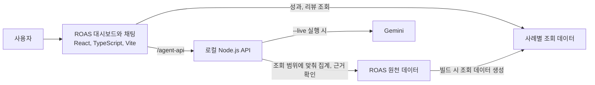

# 마케팅 분석 Agent PoC

광고 성과가 달라졌을 때, 어디서 변화가 시작됐고 다음에 무엇을 확인하면 좋을지 살펴보는 도구입니다. 퍼포먼스 마케터가 광고비 대비 매출(ROAS)을 확인하고, 지표 상세와 AI 대화를 오가며 판단 근거를 찾을 수 있어요.

현재는 가상 데이터로 분석 흐름을 확인하는 PoC입니다. 실제 광고 집행은 하지 않습니다.

[메인 화면](https://marketing-agent-poc.vercel.app/workbench) | [개발 미리보기](https://marketing-agent-poc-git-dev-cracker5.vercel.app/workbench)

## 이렇게 써요

1. **성과 현황에서 변화를 봐요.** S01~S18 중 사례를 고르고 캠페인, 매체, 기기 등으로 범위를 좁혀요. 분석 기간의 ROAS와 주요 지표를 직전 14일과 비교할 수 있습니다.
2. **눈에 띄는 지표를 열어요.** 상세 화면에서 기간별 수치와 항목별 증감을 비교해요. 표의 행을 펼치면 집계 내역과 관련 운영 기록을 확인할 수 있습니다.
3. **해석이 막히면 AI에 물어봐요.** “이번 기간에 ROAS가 왜 떨어졌나요?”처럼 질문하면 현재 화면의 조회 범위를 바탕으로 결론, 판단 근거, 다음 확인 항목을 정리해 줍니다. 답변에 포함된 표, 그래프, 인용 자료도 함께 확인할 수 있어요.

리뷰 분석 메뉴에서는 사례에 연결된 리뷰를 따로 살펴볼 수 있습니다.

## 화면과 AI 서버가 연결되는 방식



대시보드는 Vite가 제공하는 사례별 성과와 리뷰 데이터를 읽습니다. 채팅 서버를 띄우지 않아도 화면을 둘러볼 수 있어요. 채팅에 질문하면 별도 Node.js API가 같은 사례의 원천 데이터에서 수치와 근거를 가져옵니다. 기본 실행에서는 모델 호출을 로컬 응답으로 대체하고, `--live`로 실행하면 Gemini를 호출합니다.

Vercel에는 화면과 조회용 데이터가 올라갑니다. 배포 화면에서 채팅을 쓰려면 로컬 API 서버를 실행하고 연결을 설정해야 합니다. [배포와 API 연결 설정](docs/deployment.md)

## 폴더 구조

```text
marketing-agent-poc/
├─ frontend/roas/  성과 현황, 지표 상세, 리뷰, 채팅 화면
├─ backend/roas/   채팅 API, 데이터 조회, 모델 연결
├─ shared/roas/    화면과 서버가 함께 쓰는 지표 집계, 답변 형식
├─ data/roas/      사례 데이터와 파일 목록
├─ scripts/roas/   로컬 API 실행, Vite 데이터 제공, 검산
├─ tests/roas/     현재 ROAS 회귀 테스트
├─ legacy/        구 CTI 대시보드, 분석과 예산 검토, 당시 데이터
├─ docs/          설계, 버전별 개발 일지, AI 활용 교훈
└─ evidence/      검증 결과와 화면 캡처
```

구 CTI 대시보드는 `npm run dev:legacy`로 별도로 열 수 있습니다. [현재 데이터 안내](data/README.md), [ROAS와 구 대시보드 분리 기록](docs/design/roas-legacy-separation.md)

## 로컬에서 실행하기

Node.js 22.13.0 이상이 필요합니다. 저장소 루트에서 아래 명령을 실행하고 브라우저에서 `http://127.0.0.1:5173/workbench`를 열면 됩니다.

```powershell
npm ci --include=dev --include=optional
npm run dev
```

채팅도 써보려면 별도 터미널에서 `npm run start:agents`를 실행하세요. 실제 모델을 연결할 때는 서버용 `.env.local`을 설정하고 `npm run start:agents -- --live`로 실행합니다. ROAS 회귀 검사는 `npm run test:roas`로 실행할 수 있습니다.

## 버전별 개발 기록

| 버전 | 바뀐 점 |
| --- | --- |
| [v0.1.0](docs/iterations/v0.1.0.md) | CTI 고정 시연을 만들고 분석 근거에서 실행안 검토까지 이어지는 흐름을 구성했어요. |
| [v0.2.0](docs/iterations/v0.2.0.md) | 마케팅 원천을 공통 형식으로 조회할 수 있게 정리하고, 질문별 검산과 온톨로지 검증을 추가했어요. |
| [v0.3.0](docs/iterations/v0.3.0.md) | 대시보드와 당시 기준 데이터(CURRENT)를 한곳에서 조회할 수 있게 합쳤어요. |
| [v0.4.0](docs/iterations/v0.4.0.md) | 분석, 예산 검토, 승인 흐름을 대화 화면에 연결했어요. 이후 같은 버전의 후속 작업으로 ROAS 전용 대시보드와 사례별 지표 상세 화면을 구성했어요. |
| [v0.4.1](docs/iterations/v0.4.1.md)~[v0.4.7](docs/iterations/v0.4.7.md) | 기존 ROAS 화면의 데이터와 탐색을 개선하고, 조회 API, 채팅 답변, 사례별 예시 질문을 다듬었어요. |
| [v0.4.8](docs/iterations/v0.4.8.md)~[v0.4.18](docs/iterations/v0.4.18.md) | 상세 비교 표, KPI 표시, 정렬, 사이드바를 여러 차례 손봤어요. |
| [v0.4.19](docs/iterations/v0.4.19.md) | 현재 ROAS 앱을 구 CTI 대시보드와 분리했어요. 구 화면과 데이터는 `legacy/`에 모아 별도로 실행할 수 있게 했습니다. |

패치별 변경과 검증, 커밋 대응, 설계 문서는 아래에서 더 볼 수 있어요. [버전별 개선 일지](docs/iterations/README.md), [버전 대응표](docs/iterations/version-history.md), [전체 문서 안내](docs/README.md)
