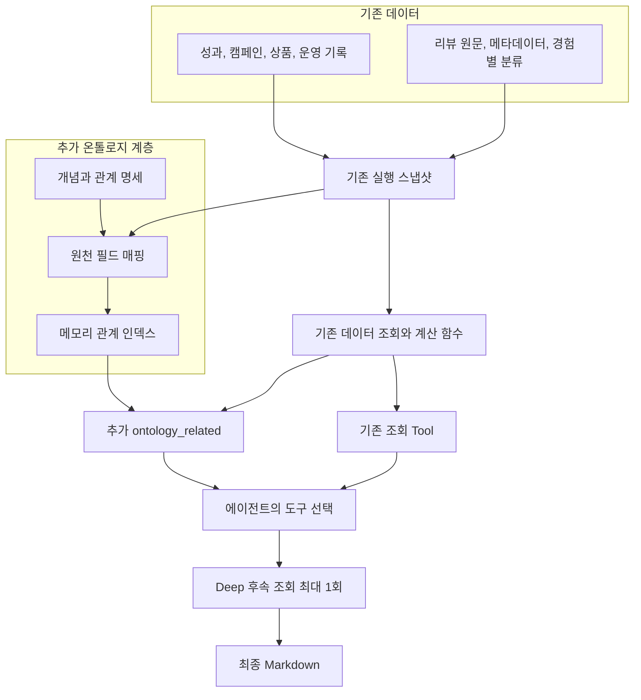
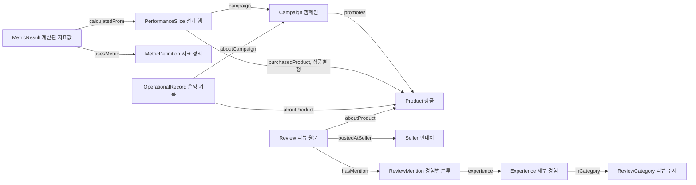
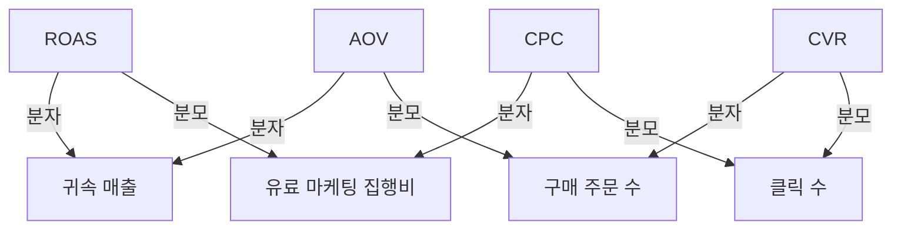
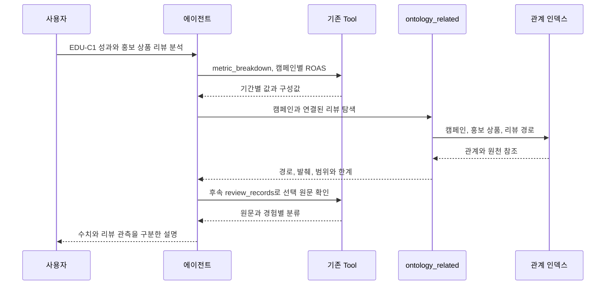

# ROAS 온톨로지 설계 가이드와 적용 계획

작성: 2026-11-10, Asia/Seoul. 상태: **설계와 인계 문서화, 구현 전**. 발행 버전: 미확정.

온톨로지는 성과, 캠페인, 상품, 운영 기록과 리뷰 사이의 의미와 관계를 연결한다. 관계 탐색은 온톨로지가, 원천 조회와 수치 계산은 기존 도구가 맡는다. 목표는 관련 근거와 반대 근거를 더 잘 찾는지 확인하는 것이며, 온톨로지의 우위를 전제하지 않는다.

이 문서는 2026-11-10 대화의 적용 계획, 아키텍처 재설계, 시각화와 데이터/Tool 연결 설명을 통합한 정본이다. 구현 중 변경과 결과도 여기에 이어 기록한다. [다른 에이전트용 작업 지시서](../handoffs/roas-ontology-implementation.md)는 이 문서를 참조하는 실행 순서 요약이다.

## 1. 결정 상태와 현재 기준선

### 1.1 사용자가 선택한 방향

| 항목 | 사용자 선택 |
| --- | --- |
| 첫 적용 범위 | 현재 ROAS와 리뷰, 캠페인, 상품, 운영 기록 |
| 우선 효과 | 관계 탐색과 해석 개선, 관련 근거와 반대 근거 대조 |
| 조사 깊이 | 일반 방식과 온톨로지 방식 모두 후속 조회 최대 1회 추가 |
| 저장 구조 | 기존 Node 서버의 메모리 활용, 전용 그래프 DB 제외 |
| 사용 방식 | 기존 채팅에서 일반/온톨로지 선택, 별도 동일 조건 비교 평가 |
| 설계 초점 | 개념, 관계, 계층, 원천 매핑과 조회 아키텍처 |

위 방향 선택과 아래의 세부 설계 제안은 구분한다. 클래스, 관계, 제약, API 필드와 DB 열의 개별 변경 승인은 아직 기록되지 않았다. 이번 사용자 요청은 문서 저장과 다른 에이전트용 지시서 작성이다.

### 1.2 조사한 현재 상태

- 기준 HEAD: `bc28afe40327fc5f5b9751a58eb663ca437ec177`, 브랜치: `fix/agent-deep-glm-fallback-20261109`. 다수의 기존 미커밋 코드, 테스트, 문서와 미추적 파일이 있다. HEAD만으로 당시 작업본을 재현할 수 없으며 실행 직전에 실제 diff와 파일 해시를 다시 고정한다.
- Iteration 인덱스의 최신 일지는 v0.4.21이다. 이번 문서에 새 발행 버전이나 구현 완료 상태를 부여하지 않는다.
- `trainingScreenData()`와 `reviewQuery()`가 현재 자료를 로드한다. 실행 도구는 같은 실행 안에서 읽기 전용 스냅샷을 사용한다.
- 지표 정의와 계산, 조회 가능 차원은 이미 구현되어 있다. 현재 Jev 경로는 조회 전에 도구와 옵션을 고른 뒤 조회 결과로 바로 답변한다. 결과를 보고 다시 조사하는 단계와 온톨로지 도구는 추가 대상이다.
- 현재 데이터는 합성 자료다. 리뷰 원천은 S16 60건, S17 25건, 총 85건이며 EDU-P1 대상이다. 특정 스냅샷에서 실제 조회 가능한 건수는 수집일과 `asOf`에 따라 판단한다.
- [최신 에이전트 SDD](agent-development-sdd.md)의 답변 자동 검증 제거와 최종 생성 입력 계약을 유지한다. 과거 문서의 인용 강제, 답변 보류, 자동 검증 규칙을 복원하지 않는다.

### 1.3 범위와 제외

현재 18개 ROAS 사례의 성과와 제공된 운영 기록을 대상으로 하며 리뷰 미제공 사례도 처리한다. 과거 41개 유형의 전면 통합, 실제 광고 계정 연결, 그래프 편집 UI, 전용 DB, 임의 코드/SQL/그래프 쿼리 실행, 광고 변경과 조치 추천은 제외한다. 환불 차감은 현재 에이전트 범위를 유지한다.

## 2. 설계 가이드라인

| ID | 지침 | 이유 |
| --- | --- | --- |
| OG-01 | 같은 원천과 고정 스냅샷을 양쪽 방식에 제공한다. | 온톨로지에만 새 사실이나 정답을 주는 비교를 피한다. |
| OG-02 | 기존 계산 함수를 재사용하고 온톨로지에 별도 계산 엔진을 만들지 않는다. | 같은 지표의 계산 결과가 달라지는 것을 막는다. |
| OG-03 | 성과 행과 단일 지표값을 구분한다. | 한 행에 여러 지표가 있으므로 단일 Observation으로 오인하지 않는다. |
| OG-04 | 홍보 상품과 구매 성과 대상 상품을 다른 관계로 둔다. | 캠페인 전체 매출을 홍보 상품 매출로 치환하지 않는다. |
| OG-05 | 운영 설정, 상태, 점검과 변경을 모두 사건으로 강제하지 않는다. | 발생 시점과 설정 유효기간을 임의로 생성하지 않는다. |
| OG-06 | 리뷰의 감성을 경험별 분류에 붙인다. | 한 리뷰 안의 긍정/부정 경험을 뒤섞지 않는다. |
| OG-07 | 명시된 ID로만 연결하고 이름 유사성으로 병합하지 않는다. | 사례, 상품과 판매처의 잘못된 동일시를 방지한다. |
| OG-08 | 시간적 동시성, 수학적 구성, 직접 대상 관계를 구분한다. | 인과관계나 원인 확률을 사실로 만들어내지 않는다. |
| OG-09 | 원천 관계와 정의 관계에 각각 근거를 남긴다. | 모든 연결의 생성 이유를 역추적한다. |
| OG-10 | 구조 검사는 개발/평가에서 수행한다. | 제거된 최종 답변 자동 검증과 보류를 재도입하지 않는다. |
| OG-11 | 없는 값과 관계를 보완하지 않는다. | 미제공, 빈 결과, 미분류, 계산 불가를 그대로 표현한다. |
| OG-12 | 필요한 관계만 메모리에 구성한다. | 범용 그래프 플랫폼과 전체 수치의 노드화를 피한다. |

## 3. 전체 아키텍처

아래 그림에서 기존 데이터와 Tool은 현재 구현, 매핑과 관계 인덱스 및 `ontology_related`는 추가 설계다. Mermaid 코드 블록은 편집 가능한 구조도 원본이며 별도 복사본을 관리하지 않는다.



- 데이터 계층: 승인된 원천과 기존 파생 조회를 제공한다. 내용과 manifest를 변경하지 않는다.
- 온톨로지 계층: 개체, 관계, 문맥과 출처를 연결한다. 관계 인덱스는 실행 중 첫 관계 조회 때 만들고 실행 종료 시 해제한다.
- 조회/계산 계층: 기존 `selectFacts`, `selectBreakdowns`, `selectRecords`, `summarize`, `metricResult` 등을 재사용한다. 관계 도구도 내부 읽기 함수를 공유하며 엔진을 재귀 호출하지 않는다.
- 에이전트 계층: 탐색 결과를 보고 필요한 조회를 선택한다. 도구 출력이 정답이나 인과 판정이라는 전제를 두지 않는다.

## 4. 도메인 모델과 관계

### 4.1 개념 관계도



### 4.2 개념과 개수 제약 제안

| 개념 | 속성과 의미 | 관계 제안 |
| --- | --- | --- |
| Campaign | ID, 매체, 플랫폼, 집행 유형, 노출 기준 | 현재 원천의 홍보 상품 1개, 없는 경우 연결을 만들지 않음 |
| Product | ID, 원천별 표시명, 제공된 메타데이터 | 명시된 원천 ID로만 식별 |
| PerformanceSlice | 원천 행, 날짜, 기기, 집계 단위, 원천 수치 | 캠페인 1개, 상품별 행에만 구매 상품 1개 |
| MetricDefinition | 산식, 구성 필드, 단위, 적용 조건, 버전 | 분자/분모와 일반 관련 지표 관계 구분 |
| MetricResult | 값, 계산 범위, 분자, 분모, 계산 불가 사유 | 지표 정의 1개, 계산 입력 행 0개 이상; 값이 있으면 입력 필요 |
| OperationalRecord | category, date, title, 원천 values | 캠페인 0..1, 상품 0..1; 미지정은 전체 대상의 직접 근거가 아님 |
| Review | 원문, 별점, 작성일, 수집일 | 상품 1개, 판매처 1개, 경험별 분류 0개 이상 |
| ReviewMention | 원천 assignment, 감성, evidenceQuote | 리뷰 1개, 세부 경험 1개; assignment별 식별 |
| Experience | 기존 경험 ID, 이름, 정의 | 기존 상위 주제 1개 |
| ReviewCategory | 기존 분류 ID와 이름 | 세부 경험 0개 이상 |
| Seller | 원천 sourceId와 표시명 | 광고 매체의 source와 다른 유형 |

`PerformanceSlice`는 여러 수치가 있는 원천 행 묶음이며 공통 규약의 단일 지표 `Observation`과 동일시하지 않는다. `MetricResult`는 기존 `AnalysisResult`의 계산 결과 개념을 따른다. 성과 행의 모든 필드를 개별 노드로 펼치지 않고 필요한 계산 결과만 조회 시 구성한다.

운영 기록의 date를 유효기간으로 바꾸지 않는다. 변경 전후와 적용 시각은 해당 원천 필드가 있을 때만 보존한다. 리뷰 별점과 감성은 별개이며 미분류 리뷰에도 임의 감성을 넣지 않는다.

날짜, 기기, 노출 기준, 매체 코드, 소재 ID, 재고 수량과 가격은 첫 적용에서 속성으로 유지한다. 독립적인 관계 탐색이 필요한 핵심 업무 대상과 리뷰 경험부터 개체화한다.

### 4.3 기존 온톨로지와의 호환

[공통 의미 규약](../research/marketing-ontology/common-contract/semantics.md)의 Campaign, Product, MetricDefinition, Review와 출처 개념을 재사용한다. ROAS 전용 클래스/관계 확장과 제약 묶음을 별도로 정의한다. 과거 브랜드, 시장 범위, 유효기간 필수 제약을 현재 자료에 일괄 적용하거나 이를 맞추기 위해 값을 생성하지 않는다.

명세는 Turtle과 대응 매핑으로 표현하고, 런타임은 메모리 인덱스를 사용한다. RDF 표현과 인덱스가 같은 원천 관계를 나타내는지 개발 시 확인한다. SHACL은 구조 제약 검사이며 답변의 정확성이나 인과관계 보증이 아니다. [W3C RDF](https://www.w3.org/TR/rdf11-concepts/), [W3C SHACL](https://www.w3.org/TR/shacl/)

## 5. 지표 의미와 범위



같은 범위와 정의를 사용하고 필요한 분모가 0이 아닐 때 `ROAS = AOV × CVR ÷ CPC`다. 수학적 구성 관계이며 현실의 원인이나 기여도 산정 방법 자체를 증명하지 않는다.

- 산식과 집계는 [기존 지표 사전](../../backend/roas/tools/metrics.mjs)과 [계산 함수](../../shared/roas/training-dashboard.mjs)를 사용한다. 분자/분모를 각각 합산한 뒤 계산하며 비율을 단순 평균하지 않는다.
- ROAS의 내부 비율과 퍼센트 표시를 구분한다. 비용은 현재 광고비와 클릭당 콘텐츠 제휴 수수료 정의를 따른다. 제작비 등 없는 비용을 추가하지 않는다.
- `relatedMetrics`와 산식 의존 관계를 구분한다. 일반 관련 지표를 모두 분자/분모로 바꾸지 않는다.
- 분모 0, 빈 자료와 미제공은 기존 계산 결과와 사유를 유지한다. 이 작업에서 기존 계산기의 결측 정책을 별도 변경하지 않는다.

| 문맥 | 내용 | 연결 규칙 |
| --- | --- | --- |
| 데이터 | caseId, snapshot, 자료 버전, asOf | 다른 합성 사례와 스냅샷을 섞지 않음 |
| 조회 | 기간, 매체, 캠페인, 기기 | 기존 primary/comparison 범위를 지킴 |
| 측정 | facts/product/traffic, 귀속, 노출 기준, 단위 | 다른 집계 단위와 정의를 임의 합산하지 않음 |

`facts`, 상품별 breakdown, 트래픽별 breakdown은 합산 가능한 독립 원천이 아니다. 캠페인/기기 집계는 facts, 상품은 product breakdown, 트래픽 차원은 traffic breakdown을 사용한다. 실제 지원 차원은 기존 capabilities를 따른다.

기간은 `[start,end)`다. 리뷰는 작성일로 기간을 나누고 기존 수집일/asOf 규칙으로 가용성을 결정한다. 캠페인과 기기로 특정할 키가 없는 리뷰는 상품 수준 참고 자료임을 명시한다. 공통 지표, 분류나 문맥 노드를 다른 사례로 넘어가는 탐색 경로로 사용하지 않는다.

## 6. 데이터 매핑과 메모리 구조

### 6.1 원천 매핑

| 기존 자료 | 필드/로더 | 생성할 표현 |
| --- | --- | --- |
| training-dashboard.json | trainingScreenData(), campaigns | Campaign, advertisedProductId 기반 promotes |
| 상품 목록, roas-product-metadata.json | products.id, productId | Product, 출처별 표시명과 메타데이터 |
| facts | id, date, campaignId, device, 수치 | PerformanceSlice, 캠페인 관계 |
| product breakdown | dimension=product, key | PerformanceSlice와 구매 상품 관계 |
| traffic breakdown | dimension=traffic, 차원 필드 | PerformanceSlice와 차원 속성 |
| records | id, category, campaignId, productId, values | OperationalRecord, 명시된 대상 관계 |
| roas-reviews.json | reviewQuery(), productId, sourceId | Review, Seller |
| roas-review-classification.json | reviewId, assignments[] | ReviewMention, Experience, ReviewCategory |
| 기존 지표 사전/계산 함수 | metrics, metricResult 등 | MetricDefinition, 조회 시 MetricResult |

실제 로더: [성과 로더](../../scripts/roas/training-data.mjs), [리뷰 로더](../../scripts/roas/review-data.mjs), [현재 도구 런타임](../../backend/roas/tools/index.mjs). 원천 구조를 그대로 복사한 별도 데이터 저장소를 만들지 않는다.

### 6.2 식별과 출처

- 개체 키: caseId + snapshot + 유형 + 원천 ID. 자료 버전은 인덱스 문맥에 포함한다. 같은 이름이나 EDU-P1이라는 코드만으로 사례를 가로질러 병합하지 않는다.
- ReviewMention 키: 원천 reviewId + assignment 위치 + 분류 버전. 근거 인용문은 원문 그대로 보존한다.
- 계산 결과는 실행 안에서 조회 조건과 metric ID로 식별한다.
- 원천 관계에는 자료 식별자, 행 ID, fieldPath와 매핑 버전을 남긴다. 정의 관계에는 정의 ID와 버전을 남긴다.
- 읽기 전용 파생 자료는 파생 경로와 입력 출처를 기록한다. 이를 실제 주문/고객 원본으로 표시하지 않는다.
- 원문에 없는 관계, 시점, 감성, supports/counters, causal_effect를 생성하지 않는다. 설명 후보와 인과 판단은 사실 그래프에 저장하지 않는다.

### 6.3 인덱스

`nodesById`, `outgoingById`, `incomingById`, `sourceRefs`의 네 구조를 Node Map과 관계 목록으로 구성한다. 동일 실행에서 재사용하고 종료 시 해제한다. 전체 관계망을 최종 모델 입력으로 전달하지 않는다. 요청 경로와 필요한 값/원문만 전달하고 출처 상세는 실행 로그에서 추적한다.

## 7. Tool 계약과 질문 처리

### 7.1 기존 Tool과 추가 Tool

| Tool | 책임 |
| --- | --- |
| overview | 범위의 성과 개요 |
| metric_components | 지표 산식과 실제 분자/분모 |
| metric_breakdown | 지표별 그룹 비교 |
| trend | 기간별 일별 추이 |
| records | 운영 기록 원문 |
| review_summary, review_records | 리뷰 집계, 원문과 경험별 분류 |
| evidence | 같은 실행에서 발급한 ID로 자료 재조회 |
| ontology_related, 추가 | 대상에서 근거로 이어지는 관계와 출처 탐색 |

Jev 경로의 metric_components/metric_breakdown과 기존 호환 경로의 metric_detail을 구분한다. 온톨로지 추가 명목으로 기존 호환 도구를 제거하지 않는다.

### 7.2 ontology_related 제안 계약

```json
{
  "scopeRole": "primary",
  "focusType": "campaign",
  "focusIds": ["EDU-C1"],
  "target": "reviews",
  "periodId": "both"
}
```

이는 기존 ID로 작성한 제안 인터페이스이며 구현된 호출이나 신규 원천 레코드가 아니다.

- scopeRole: 기존에 잠긴 primary/comparison 중 하나.
- focusType: campaign/product/metric/review_topic. review_topic은 기존 Experience 또는 ReviewCategory의 구분된 식별자 사용.
- focusIds: 서버가 제공한 현재 범위의 식별자, 최대 6개. 이름 추정으로 대체하지 않음.
- target: operations/reviews/performance/all. periodId: baseline/current/both.
- offset/limit: 기존 페이지 규약, 기본 및 최대 24개 경로.
- 최대 3단계의 허용 업무 관계를 탐색한다. 경험별 분류와 출처는 부속 상세로 붙이며 다른 개체로 확장하는 우회로로 사용하지 않는다.
- 경로의 관계 유형과 원천 ID 순으로 안정 정렬하고 중복 경로를 제거한다. 같은 리뷰가 여러 경로에 등장해도 원문은 한 번만 담고 참조한다.
- 반환: status, 적용 범위, paths, 원천 값/원문 발췌, sourceRefs, limitations, total/nextOffset/truncated, 추가 조회 후보. 내부 그래프 식별자를 인과 신뢰도나 순위로 해석하지 않는다.
- 연결 없음은 empty, 자료 자체 미제공은 not_provided, 잘못된 범위는 해당 도구 오류다. 관계 인덱스 오류는 기본 도구의 성공 결과를 폐기하지 않는다.
- 자유 SQL/Cypher/SPARQL, 임의 파일과 날짜를 입력받지 않는다. 기존 인증과 범위 제한을 통과한 자료만 사용한다.

### 7.3 대표 조회 경로

| 시작점 | 허용 경로 | 해석 |
| --- | --- | --- |
| 캠페인 | 캠페인 ← 성과 행 → 계산 결과 | 해당 범위의 성과 |
| 캠페인 | 캠페인 ← 운영 기록 | 명시된 대상의 기록 |
| 캠페인 | 캠페인 → 홍보 상품 ← 리뷰 | 상품 수준 후기, 캠페인 유입 고객 후기가 아님 |
| 상품 | 상품 ← 상품별 성과 | 상품에 배분된 성과 |
| 상품 | 상품 ← 운영 기록 | 해당 상품의 운영 자료 |
| 경험 | 경험 ← 경험별 분류 ← 리뷰 | 감성 조합과 실제 인용문 |
| 지표 | 지표 → 구성값과 지원 차원 | 다음 계산/비교 조회 후보 |

확인한 S16 예시: EDU-C1의 advertisedProductId는 EDU-P1이며, REV-S16-005는 해당 상품의 리뷰다. 기존 분류에 scent_intensity, negative가 있다. 이 경로는 상품 관련성을 보여주며 ROAS 하락이나 광고 유입의 인과 증거가 아니다.



## 8. 공통 조사 흐름, API와 UI

### 8.1 실행 흐름 제안

1. Jev가 경로와 필요한 도구를 선택한다.
2. 조회 옵션을 고르고 첫 조회를 실행한다.
3. Deep 질문은 결과 요약, 자료 누락과 조회 후보를 보고 후속 조회 필요성을 한 번 판단한다.
4. 필요한 후속 호출을 최대 4개 실행하고 최종 Markdown을 생성한다. Quick에는 후속 단계를 추가하지 않는다.

현재 Jev 모델 시도 상한 5회와 도구 상한 20회를 유지한다. 후속 판단 시작 전에 최종 생성용 시도 2회가 남도록 예산을 확인한다. 부족하거나 후속 판단이 실패하면 이미 확보한 자료로 답한다. 페이지 요청도 도구 한도에 포함하며 두 번째 후속 판단은 하지 않는다. 실제 시간 제한과 공급자 설정은 실행 당시 구성을 보존한다.

일반 방식에도 같은 후속 단계와 의미 설명을 제공한다. 동일 원천에 대한 접근 권한을 확인하고, 기본 도구에 빠진 관계 필드가 있으면 양쪽의 공통 카탈로그/조회 결과에 동등하게 제공한다. 온톨로지에만 새 사실을 주지 않는다.

### 8.2 인터페이스 변경 제안

- Run 요청과 상태에 analysisMode: baseline | ontology 추가, 생략 시 baseline.
- 요청 중복 판정에 모드를 포함한다. 같은 request ID의 모드 변경은 기존 실행 재사용이 아니라 충돌로 처리한다.
- SQLite 실행 테이블에 analysis_mode TEXT NOT NULL DEFAULT 'baseline' 추가. 기존 기록은 baseline으로 읽고 과거 답변을 재작성하지 않는다.
- 채팅에서 일반/온톨로지 선택, 기본 일반, 실행 중 선택 잠금, 답변별 방식 표시, 상세 로그에 관계 탐색과 후속 조회 표시.
- 모드 전환 후 대화는 이어갈 수 있다. 비교 평가는 모드 간 답변이 섞이지 않는 독립 이력을 사용한다.
- sourceRefs와 내부 ID는 진단용으로 유지한다. 최종 생성 입력에서는 최신 answer-context 계약에 맞춰 불필요한 추적 메타데이터와 중복 원문을 제외하되 관계 의미, 적용 범위와 한계는 남긴다.

## 9. 구현 순서와 완료 조건

| 단계 | 작업 | 완료 조건 |
| --- | --- | --- |
| P0 | 실제 작업본 확인, 매핑과 스키마 변경 명세 검토 | 기준 SHA와 dirty 상태 식별, 승인 범위 확인 |
| P1 | 공통 의미 설명과 후속 조회 1회 | 일반 방식에서 정상/실패/예산 처리 검증 |
| P2 | ROAS 전용 명세, 매핑, 메모리 인덱스 | 원천 추적, 개체/관계/문맥 일치 |
| P3 | ontology_related와 Jev/최종 입력 연결 | 관계 조회와 원문 추가 확인까지 연결 |
| P4 | API, 저장, 채팅 모드 연결 | 저장/복원, 과거 기록, 중복 요청 호환 |
| P5 | 구조 검증, 동일 조건 비교, 문서 결과 갱신 | 개선/악화/차이 없음과 미검증을 분리 보고 |

비교 기준선은 P1을 완료한 일반 방식이다. 후속 조회 추가 효과를 온톨로지 효과로 계산하지 않는다. 기능 비활성화 시 baseline으로 신규 실행하고 기존 기록은 보존한다. 관계 인덱스는 일시적이므로 복구를 위해 원천 이행이나 그래프 삭제가 필요하지 않다.

## 10. 검증과 비교 평가 계획

### 10.1 필수 기능 검사

- 같은 입력과 매핑의 인덱스 재현, 관계 원천 추적, 미정의 관계 검출.
- 사례/스냅샷 격리, 홍보 상품과 구매 상품 분리, 공통 지표 노드를 통한 범위 우회 방지.
- facts/product/traffic 중복 합산 방지, 기존 계산값과 동등성, 광고/콘텐츠 노출 기준 구분.
- 리뷰 작성일/수집일/기간 경계, 경험별 감성/인용 조합, 긍정/부정/혼합/미분류 보존.
- 대상 미지정 운영 기록을 전체 캠페인의 직접 근거로 연결하지 않음.
- empty/not_provided/error 구분, 페이지와 중복 원문 처리, 후속 조회/취소/공급자 대체/예산 소진.
- baseline에 온톨로지 도구 미노출, 모드 저장/복원/중복 요청, 과거 기록 호환.
- 최종 Markdown 무수정 전달, 자동 답변 검증과 보류 미복원.

기존 자료를 재사용한다. 새로운 합성 fixture나 원천 변형값이 필요하면 구체적 규칙을 승인받기 전 생성하지 않는다. 기대값은 같은 구현 함수의 복사가 아닌 원천 필드 대조와 독립 검산으로 정한다.

검사 명령: `npm run test:agents`, `npm test`, `npx tsc --noEmit`, `npm run lint`, `npm run build`. 브라우저에서 모드 변경, 질문 실행, 로그, 취소와 재조회/복원을 확인한다. RDF/SHACL 및 논리 검사는 변경한 ROAS 명세에 적용하고 과거 도구를 재사용할 때 [로컬 검증 안내](../research/marketing-ontology/common-contract/local-validation.md)를 따른다. 외부 검사 서비스 전송은 포함하지 않는다.

### 10.2 비교 평가

대표 2개 질문으로 연결 상태를 점검한 후 다음 12개 과업의 문구, 필터, 기대 근거를 실행 전에 고정한다. 각 과업을 양쪽 방식으로 3회씩, 총 72개 답변으로 비교한다. 과업 11의 본평가 스냅샷은 하나로 고정하고 initial/mature 가용성 차이는 별도 구조 회귀에서 대조한다. 연결 점검과 별도 회귀는 72개 본평가 답변에 포함하지 않는다.

| 번호 | 과업 |
| --- | --- |
| 1 | S16 ROAS 변화와 관련된 캠페인/운영 기록 찾기 |
| 2 | S16 기기별 성과와 해당 범위 운영 기록 비교 |
| 3 | S16 EDU-P1 운영 기록과 리뷰 변화 조사 |
| 4 | 같은 리뷰 경험의 긍정/부정 원문 대조 |
| 5 | S16 판매처별 리뷰 차이를 고려한 설명 후보 검토 |
| 6 | S17에서 동일 조사 흐름 재현 |
| 7 | 리뷰 미제공 S18 조사 |
| 8 | 리뷰 없는 EDU-P2 요청 |
| 9 | 특정 캠페인 유입 고객의 리뷰 요청 |
| 10 | 운영 변경만으로 원인을 확정하라는 요청 |
| 11 | 같은 사례 initial/mature의 자료 가용성 차이 대조 |
| 12 | 현재 ROAS 단순 조회 회귀 |

질문, 필터, 스냅샷, 대화 이력, 실제 모델, 실행 예산과 평가 기준을 맞춘다. 실행 순서는 교차하고 모델/제공자가 달라진 쌍은 통제 비교에서 분리한다. 현재 일일 호출 제한은 해제하지 않고 필요하면 여러 날에 나눈다.

평가는 핵심 근거 발견율, 반대 근거 확인, 잘못된 관계 연결, 인과 과장, 수치 정확성, 토큰/호출/지연, 구축 및 유지 부담을 본다. 방식 이름을 가린 원천 대조 평가를 사용하고 사람 검토 전에는 잠정 평가로 표시한다. 근거 탐색이 개선돼도 해석 오류가 늘면 개선으로 판정하지 않는다. 차이가 없거나 비용만 늘면 일반 방식을 기본으로 유지한다.

## 11. 승인, 기록과 인계 경계

[프로젝트 AGENTS.md](../../AGENTS.md)는 스키마의 필드, 타입, 관계, 제약, 의미 변경과 신규 데이터 생성에 구체적 제안과 개별 승인을 요구한다. 아래는 **미승인 변경 제안 목록**이며 문서 저장이나 일반적인 실행 요청을 승인으로 대신하지 않는다.

| 제안 | 목적과 범위 | 검산/복구 |
| --- | --- | --- |
| ROAS 전용 개념, 관계, 제약과 매핑 | §§4~6의 의미 계층, 기존 원천 값은 유지 | 원천 역추적, 구조 검사, 인덱스 해제 |
| ontology_related 및 공통 카탈로그 확장 | §7의 탐색 계약과 양쪽 정보 접근 동등성 | 도구 계약/범위/실패 회귀 |
| analysisMode, analysis_mode | §8의 요청/응답과 저장 계약 | 기존 기록 baseline 해석, 데이터 보존 |

실행 담당자는 범위가 정리된 변경 명세와 검증 방법을 제시하고 [데이터 승인 기록](../research/marketing-ontology/data-proposal.md)에 실제 승인만 기록한다. 스키마 승인과 무관한 기존 자료 조사, 매핑 감사와 문서 정리는 먼저 진행할 수 있다.

기존 변경을 되돌리거나 임의 stash/브랜치 전환/별도 worktree를 만들지 않는다. Git 발행은 [개발 운영 절차](../DEVELOPMENT-WORKFLOW.md)와 실제 사용자 권한을 따른다. 이번 문서화에는 구현, 모델 호출, 커밋, push와 배포가 포함되지 않는다.

## 12. 문서화 결과와 미검증

2026-11-10: 대화의 계획과 구조도 4개, 원천 매핑, Tool 연결, 인수 기준을 이 문서에 통합하고 짧은 작업 지시서를 작성했다. 기존 문서 안내, 에이전트 SDD와 결정 인덱스에서 연결한다.

문서 검사: Node 읽기 전용 검사로 신규 두 문서의 로컬 링크 13개 존재, 코드 블록 균형과 Mermaid 4개, 금지 구분자 미사용을 확인했다. 안내/SDD/결정 인덱스는 추가 문단을 제외한 기존 본문 해시가 일치하며, 사전 기록한 다른 변경 파일의 해시도 유지됐다. 수정한 기존 문서의 `git diff --check`는 종료 코드 0이다. Mermaid 실제 렌더링은 미실행이며 앱 테스트 통과를 뜻하지 않는다.

앱 구현, 새 스키마 적용, 새 데이터 생성, 실모델 72답변 평가, 성능 측정과 배포는 미실행이다. 과거 온톨로지 검증 통과를 현재 ROAS 구현 통과로 승계하지 않는다.

## 13. 구현 전 원천 매핑 감사와 개별 변경 승인 명세, 2026-11-10

**상태: 원천 읽기 전용 감사 완료, 변경 제안 미승인, 코드 및 데이터 변경 미실행.** 이 절은 §§4~8의 설계를 실제 현재 소스에 대조한 승인용 상세 명세다. 별도 계획서를 만들지 않는다.

### 13.1 작업본과 원천 기준선

- 작업 폴더: `marketing-agent-poc/`, HEAD `bc28afe`. 감사 당시 브랜치는 `feat/jev-classification-roas-impact-20261110`; Jev, Engine, Tool, Store, UI 및 문서의 기존 미커밋 변경을 보존했다. 원래 문서화 당시의 브랜치와 현재 작업본이 다르므로 HEAD만으로 현행 코드를 재현할 수 없다.
- 현재 데이터 파일 SHA-256: `training-dashboard.json` `4ada40bb6153fcc40cdaa2654c48aaa3cccd46c489a1558ad888d5a0d2e80c66`, `roas-reviews.json` `e6db65aea443f0c3559fd53cd36df2faa128c571af642e16d960d2e720f0e6e1`, `roas-review-classification.json` `49f25e184f6722db9fde3c2ed139431c467cd51a2f11902e12f60ba9f7376077`, `roas-product-metadata.json` `7349c2c37f1c7238d1ae1973aacafd501a595c4c56f31a8e44310de1be6491cd`. 모두 현행 manifest의 해당 항목과 일치한다. manifest `data_sha256`은 `dfbb81a0e1b3349f9c7b06b0b29971ac7306d0a6501621e9775748c47ae7020b`.
- 현재 `training-dashboard.json`은 18개 사례, 사례별 캠페인 6개, facts 336행, 상품 분해 1,008행, traffic 분해 672행, 전체 운영 기록 원천 108건이다. `matureOverrides`에 성과 변경이 명시된 사례는 S15만 있으므로 S16/S17의 두 스냅샷을 임의로 서로 다른 성과 자료라고 설명하지 않는다.
- 18개 사례의 `campaigns[].advertisedProductId`, 상품 분해 `key`, 운영 기록 `campaignId`와 `productId`의 현재 참조 누락은 0건이다. 운영 기록은 사례별 `recordIds`를 따라 연결하며 원천 배열의 전역 행을 다른 사례에 연결하지 않는다.
- 리뷰 원천은 S16 60건, S17 25건, 두 판매처다. 경험 분류는 5개 상위 주제, 18개 경험, `reviewClassifications` 85건(분류 81건, 미분류 4건), assignment 106개다. `reviewQuery`의 initial/mature 기준 현재 가용 건수는 각각 S16 60, S17 25, S18 미제공이고, 작성일 기준 기간 건수는 S16 27/33, S17 12/13이다. 현재 자료에서 두 스냅샷의 리뷰 가용 건수는 같다.
- 읽기 전용 기준 회귀: `npm.cmd run test:agents` 110/110 통과, `npm.cmd test` 72/72 통과. 이 결과는 **기존 구현의 기준선**이며 신규 온톨로지나 최종 72답변 평가의 검증 결과가 아니다.

### 13.2 원천 필드와 의미의 대조

| 표현 대상 | 실제 필드와 연결 원천 | 금지할 변환, 주의할 차이 |
| --- | --- | --- |
| Campaign, Product, promotes | `trainingScreenData().campaigns[].id,advertisedProductId` → 같은 사례의 `products[].id` | `products[].label`은 교육용 표시명이고 승인된 `roas-product-metadata.json`의 `EDU-P1` 표시명은 쓱쓱샴푸다. 이름 병합 금지 |
| PerformanceSlice, campaign | `facts[].id,date,periodId,campaignId,device,exposureBasis` 및 수치 | facts 전체 성과를 특정 홍보 상품의 구매 성과로 변환 금지 |
| PerformanceSlice, purchasedProduct | `breakdowns[]` 중 `dimension='product'`인 행의 `key` → `products[].id` | S16 EDU-C1은 EDU-P1을 홍보하지만 EDU-P2와 EDU-P3의 구매 상품 행도 있다. `facts`와 분해를 중복 합산 금지 |
| traffic 차원 | `breakdowns[]` 중 `dimension='traffic'`, `source,creativeId,audienceId,placement,keyword` 등 | 첫 적용에서 상품과 traffic 교차 관계를 생성하지 않음. 광고 노출과 콘텐츠 조회의 분모 구분 |
| OperationalRecord | `recordIds`로 참조한 `records[].id,category,date,campaignId,productId,title,values` | `category=campaign/creative/landing/inventory/tracking/change/incident` 등은 모두 사건이 아니다. 대상 미지정 레코드는 전체 캠페인의 직접 증거가 아님 |
| Review, Seller | `reviewQuery({caseId,snapshotId})`의 `reviews[].id,productId,sourceId,writtenAt,collectedAt,rating,text` | 리뷰는 상품 및 판매처 단위이며 고객, 광고 유입, 주문 ID 없음. 작성일 구간, 수집일 `asOf` 미만 규칙 유지 |
| ReviewMention, Experience, ReviewCategory | `roas-review-classification.json`의 `reviewClassifications[].reviewId,status,assignments[]`, `experiences[].id,categoryId`, `categories[].id` | 감성은 `assignments[].sentiment`에만 붙이고 `evidenceQuote`는 원문 그대로. 별점이나 미분류 상태를 감성으로 보간하지 않음 |
| MetricDefinition, MetricResult | `backend/roas/tools/metrics.mjs`의 `metrics,metricCapabilities,metricResult`, 기존 조회 결과 | `relatedMetrics`를 산식 의존 관계로 혼동하지 않음. 수치 계산, 분모 0과 단위는 기존 구현만 사용 |

예시 원천 경로는 S16 `campaigns[EDU-C1].advertisedProductId = EDU-P1` → `reviews[REV-S16-001].productId = EDU-P1`이다. 리뷰에 캠페인 참조 필드가 없으므로 경로 반환값은 **홍보 상품 수준의 관련성**이며 `EDU-C1` 유입 고객의 리뷰나 ROAS 변화 원인을 증명하지 않는다.

### 13.3 개별 승인이 필요한 변경 명세

**승인 항목 A, ROAS 전용 의미 스키마와 실행별 인덱스**

- 추가 클래스 11개: `Campaign`, `Product`, `PerformanceSlice`, `MetricDefinition`, `MetricResult`, `OperationalRecord`, `Review`, `ReviewMention`, `Experience`, `ReviewCategory`, `Seller`. 기존 공통 클래스와 충돌하는 이름에는 ROAS 전용 네임스페이스와 명시적 호환 매핑을 사용한다.
- 허용 관계: `promotes`, `campaign`(성과 행의 캠페인), `purchasedProduct`, `usesMetric`, `calculatedFrom`, `aboutCampaign`, `aboutProduct`, `postedAtSeller`, `hasMention`, `experience`, `inCategory`. 이는 업무 사실/정의 연결이며 `causedBy`, `supports`, `counters`, 광고 고객 귀속 관계를 추가하지 않는다.
- 구조 제약: 성과 행의 캠페인 정확히 1개, 상품 분해 행의 구매 상품 정확히 1개, 캠페인의 홍보 상품은 원천 ID가 있을 때 최대 1개, 운영 기록의 직접 캠페인/상품 대상은 각각 최대 1개, 리뷰의 상품과 판매처 각 1개, ReviewMention의 리뷰와 경험 각 1개. MetricResult는 정의 1개, 값이 있으면 실제 계산 입력이 존재해야 한다. 미분류는 ReviewMention 0개를 허용한다.
- 매핑 형식: 각 노드에 `caseId,snapshot,type,sourceId`를 포함한 실행 내 고유 키를 사용하고, 엣지에 `sourceFile,sourceRecordId,fieldPath,mappingVersion` 또는 정의 ID와 버전을 기록한다. 원천의 결측값은 결측으로 남긴다. RDF/Turtle과 SHACL은 승인된 관계와 제약만 표현하고 런타임은 `nodesById,outgoingById,incomingById,sourceRefs` 메모리 Map으로 읽기 전용 구성, 실행 종료 시 폐기한다. 그래프 DB와 새 원천 행은 없다.
- 인수 조건: 원천 역추적, 양방향 관계 일치, 사례 및 스냅샷 격리, 미정의 엣지 거부, 분해 중복 합산 금지, 미분류 보존, 같은 입력의 재현성.

**승인 항목 B, Tool와 공통 정보 계약 확장**

- `ontology_related` 입력: `scopeRole: primary|comparison`, `focusType: campaign|product|metric|review_topic`, `focusIds: string[]`(현재 범위에 존재하는 ID만, 1~6개), `target: operations|reviews|performance|all`, `periodId: baseline|current|both`, `offset`(0 이상 정수), `limit`(1~24, 기본 24). 추가 파일, 임의 날짜, SQL, RDF 쿼리, 자유 노드 ID는 허용하지 않는다.
- 출력: `status`(ready/empty/not_provided), 실제 `appliedScope`, 관계 유형과 노드 ID를 포함한 `paths`, 중복 제거한 `records`/원문 발췌 및 `sourceRefs`, `limitations`, `total,nextOffset,truncated`, 후속 조회 후보. 잘못된 범위는 정상 empty가 아닌 기존 Tool 오류를 사용한다. 최대 3단계의 허용 관계만 이동하며 공통 지표/경험 정의 노드는 다른 사례 탐색의 우회로가 될 수 없다.
- 기존 조회 도구와 Jev 전용 metric_components/metric_breakdown, 호환 metric_detail은 그대로 유지한다. baseline에는 온톨로지 Tool을 노출하지 않되 원천 의미 설명, 리뷰 분류, 원문 및 Deep 후속 조회 권한은 동등하게 제공한다.
- 공통 Deep 후속 단계는 첫 결과를 확인한 뒤 **판단 1회, 추가 Tool 최대 4개**, Jev 총 5회, 전체 Tool 20회, 최종 생성 호출용 여유 2회와 현재 시간 제한을 모두 지키는 별도 동작 변경이다. 후속 실패 시 이미 확보한 자료로 최종 생성하며 답변 자동 보류/검증을 복원하지 않는다.

**승인 항목 C, 실행 모드와 저장 계약 변경**

- HTTP 실행 요청 및 상태, 프런트엔드 실행 상태에 `analysisMode: 'baseline'|'ontology'`를 추가하고 생략은 baseline으로 처리한다. 실행 시작 후 모드 변경 금지, 과거 이력 표시에서는 저장된 실행의 모드를 사용한다.
- SQLite `roas_runs`에 `analysis_mode TEXT NOT NULL DEFAULT 'baseline'` 열을 추가한다. 기존 테이블에서는 `PRAGMA table_info(roas_runs)`로 열 존재를 검사하고 없을 때만 `ALTER TABLE`로 이행한다. 신규 값은 두 enum 값만 허용하고 구 기록은 baseline으로 읽는다. 기존 응답/근거/30일 보관/취소는 유지한다.
- 요청의 입력 지문에 모드를 포함한다. 같은 계정, 브라우저, `clientRequestId`로 다른 모드를 제출하면 기존 `idempotency_conflict` 처리하고 기존 실행을 재사용하지 않는다. 모드에 따른 별도 대화 기록은 비교 평가용으로 구성하고 이전 완료 답변을 수정하지 않는다.
- 인수 조건: 신규/기존 DB의 동일 결과, 재실행 이행 멱등성, 기본 모드, 저장/복원, 모드별 Tool 노출, 동시 실행/취소, 기존 인증 및 요청 중복 판정 회귀.

### 13.4 승인 및 후속 검증 상태

- 위 **A, B, C는 각각 독립 승인 대기**다. 현재 대화의 작업 지시 및 기존 방향 선택만으로 승인되지 않았다. 원천, manifest, 신규 fixture와 SQLite 스키마를 변경하지 않았다.
- 원천 감사 시점에는 기존 Jev 브랜치의 미커밋 코드를 보호하기 위해 브랜치 이동과 stash, 코드 덮어쓰기를 하지 않았다. 이후 사용자의 명시적 분리 지시에 따라 독립 worktree를 생성했다.
- 구조 인덱스, RDF/SHACL, ontology_related, DB 이행, 모드 UI, Deep 후속 단계, 브라우저 조작과 실모델 72답변 비교는 **미실행**이다. 구현 승인 이후 같은 원천과 동일 후속 조회 조건으로 baseline/ontology를 비교한다.
- 추가 기준선 검사: `npx.cmd tsc --noEmit` 종료 코드 0, `npm.cmd run lint` 종료 코드 0(오류 0개, 경고 762개), `npm.cmd run build` 종료 코드 0(500kB 초과 청크 경고). `git diff --check` 종료 코드 0이며 기존 작업 파일의 LF/CRLF 변환 경고가 출력됐다. 이 결과는 온톨로지 신규 코드 검사가 아니다.
- 점검 중 다른 담당자의 Jev 진단 코드와 Evidence 등이 추가로 나타나 Git 상태가 변했다. 이번 감사자는 이를 수정, 스테이징 또는 되돌리지 않았다. 따라서 위 회귀 결과는 실행 시점의 dirty 작업본에 한정하며 향후 통합 시 재검증해야 한다.
- **브랜치 분리 기록:** 이 감사와 온톨로지 설계 문서, 승인 명세는 `bc28afe` 기반 `feat/roas-ontology-20261110` 브랜치의 별도 `marketing-agent-poc-ontology/` worktree로 이동했다. 기존 `feat/jev-classification-roas-impact-20261110`의 온톨로지 전용 문서, 링크 및 승인 명세는 분리했고 그 밖의 Jev 미커밋 구현은 보존했다. 두 브랜치 모두 커밋과 푸시는 하지 않았다.

### 13.5 A 의미 스키마 사용자 인터뷰, 2026-11-10

- **A-1 확정, B안:** 핵심 업무 개체와 지표 의미를 함께 연결한다. `MetricDefinition`과 필요 시 산출하는 `MetricResult`를 포함한 기존 11개 개념 설계 방향을 유지하되 모든 날짜별 지표 결과를 미리 노드화하지 않는다. 지표 계산과 수치 정확성은 기존 계산기와 조회 Tool을 기준으로 한다.
- **승인 범위:** A-1은 개체화 수준에 대한 설계 결정이다. A 전체의 클래스/관계/속성/제약 스키마 적용 승인이나 신규 데이터 생성 승인이 아니다. A의 나머지 항목은 후속 인터뷰에서 구체화한다.
- **A-2 인터뷰 대상, 미확정:** 운영 기록 `OperationalRecord`를 현재처럼 하나의 개념과 원천 `category` 속성으로 둘지, 근거가 있는 설정/상태/변경/점검 의미 하위형을 추가할지 결정한다. 현재 원천의 `incident` 항목 중 '사이트 운영 점검'처럼 정상 상태도 있으므로 `category`만으로 장애 사건을 단정해서는 안 된다.
