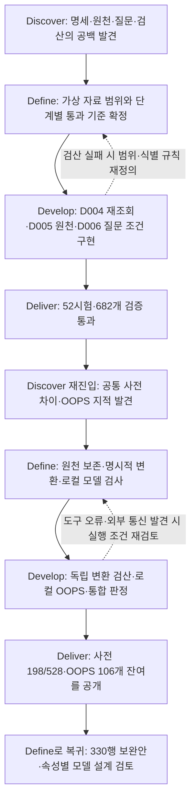

# v0.2.0 데이터·온톨로지 보강: 더블 다이아몬드와 AI 협업 기록

**질문 검증 체계는 구축했지만, 공통 데이터 규격과 모델 설계의 모든 문제를 해결한 단계는 아니다.** 이 문서는 각 작업에서 무엇을 문제로 봤고, 사용자가 AI에게 어떤 경계를 정했으며, 구현과 검증으로 어디까지 확인했는지 기록한다.

- 작성일: 2026-10-16
- 문서 기준: `dev / 6a493956f90618a1033c5b8390778babc2306253`
- 대상 커밋: `e52cef6..6a49395`의 11개 커밋
- 원래 개발 일지: [v0.2.0](v0.2.0.md)
- AI 활용의 시행착오·재사용할 원칙: [Lesson 001](../ai-lessons/lesson-001.md)

## 1. 읽는 기준과 현재 결과

여기서 데이터 확보는 **승인된 가상 원천의 준비·생성·보존**을 뜻한다. 실제 공급자 API 연결·실제 자료 수집·파일럿은 사용자가 범위에서 제외했다. 제품 화면 개편·DB 연결·LLM 답변 평가는 이 작업으로 완료했다고 주장하지 않는다.

| 용어 | 이 프로젝트에서의 의미 |
| --- | --- |
| 공통 사전 | 필드의 뜻·자료형·필수 조건·단위·기간·참조를 정한 [필드 설명서](../research/marketing-ontology/field-dictionary.md)와 [공통 스키마](../research/marketing-ontology/schemas/marketing-records.schema.json) |
| D003B / D004 | 보존된 1,652행 원천 / 그중 214행 및 전체 원천을 메모리 RDF로 검증하는 작업 범위 |
| D005 | 미구축 30종 528행과 제품 식별 지원 6행을 마련한 가상 원천 배치. 내부 규격 통과와 공통 사전 적합은 다름 |
| D006 | 기존 질문의 부족 조건을 보완하기 위해 별도 승인한 A 3행·B 53행, 판매처 선언과 메모리 오류 분기 |
| 독립 검산 | 조회·변환 함수로 기대값을 만들지 않고 별도 원천 해독·Decimal 계산과 실제 RDF 재조회로 대조. 별도 사람의 독립 검토를 뜻하지 않음 |
| HermiT / OOPS | 정의 모델의 논리 검사 / 온톨로지 설계상의 잠재 문제 검사. 도구 실행 성공과 모델 적합은 별도 판정 |

| 확인 대상 | 현재 확인된 결과 | 이 결과가 보장하지 않는 것 |
| --- | --- | --- |
| 질문 회귀 | 52/52시험·682개 assertion 통과, 실질 답변 28·보류/거부 24 | 모든 질문에 답변 가능, LLM 답변 품질·실제 마케팅 효과 |
| D004·D005 | 기존 회귀 통과. 커밋 정리 중 새 HEAD의 D005 8게이트·오류 탐지 60건도 통과 | 모든 유형의 공통 사전 적합 |
| 공통 사전 | 528행 중 198행 스키마 적합, 330행·63그룹 미충족 | 198행의 업무 의미 전체 확인 완료 |
| 모델 검사 | HermiT 통과, 로컬 OOPS 실행 완료·지적 106개 미해결 | 도구 설치만으로 모델 설계 완료 |
| 도구 자체 시험 | 오프라인 프로필 회귀 32개+유틸리티 1개=33개 통과 | 원본 38개 시험 전체 통과, OOPS 지적 해소 |
| 보존 | 보호 대상 60파일의 작업 폴더·Git 객체 바이트 일치 | 실행 보고서의 과거 HEAD를 현재 HEAD로 바꿔야 한다는 뜻 |

수치는 [최종 통합 실행](../research/marketing-ontology/common-contract/runs/2026-10-16-canonical-system-2.json), [도구 시험 근거](../research/marketing-ontology/common-contract/runs/2026-10-16-canonical-final-integrity-2.json), [커밋 후 D005 실행](../research/marketing-ontology/common-contract/runs/2026-10-16-post-commit-d005-1.json), [커밋 분리 무결성](../research/marketing-ontology/common-contract/runs/2026-10-16-commit-split-integrity-1.json)을 기준으로 한다. 이번 회고 작성에서 기능 시험을 새로 실행한 수치는 아니다.

## 2. 사용자 지시를 확인할 수 있는 범위

전체 과거 대화 원본이 저장소에 있는 것은 아니다. 아래에서 **저장된 원문**, **이번 대화 원문**, **기존 기록의 요약**을 구분한다. 지시와 결과가 이어진다는 사실은 기록하되, 대조 실험 없이 특정 프롬프트가 결과를 만들었다는 인과 효과를 수치화하지 않는다.

| ID | 사용자 지시·요구 | 출처와 해석 범위 |
| --- | --- | --- |
| U01 | 온톨로지의 올바른 구축과 반복 가능한 시스템 검증에 집중하고 후속 UI 계획은 제외 | [AGENTS.md](../../AGENTS.md)·[기존 일지](v0.2.0.md)의 요약. 원래 발화 전체를 복원한 인용은 아님 |
| U02 | “기존 데이터 재사용 승인할게. 필요한데이터는 계획먼저 세우고 더 생성하도록해” | [저장된 사용자 원문](../research/marketing-ontology/common-contract/question-approval-20261015.json). 기존 자료 재사용과 신규 생성의 경계를 분리 |
| U03 | “데이터 승인 다 해줄개 써도 돼. 하던 일 계속 해” | [D006 승인 원문·scope](../research/marketing-ontology/common-contract/d006-approval-20261016.json). 제시된 D006 범위의 승인으로 기록했으며 향후 모든 생성으로 확대하지 않음 |
| U04 | “4 반올림은 그냥 가상 임의의 반올림 하면 될 것갘아. 나머지 1,2,3,5,6은 a안으로 가자” | [저장된 선택 원문](../research/marketing-ontology/common-contract/meaning-decisions-20261016.json)의 일부. 규칙의 세부 설계는 AI가 수행. 해당 기록의 공급자 파일럿 선택은 U05로 철회됨 |
| U05 | “실제 데이터랑 연결할 필요는 없어. 그렇게까지 안할거야.” | [범위 변경 기록](../research/marketing-ontology/work-log.md)·[승인 문서](../research/marketing-ontology/data-proposal.md)에 보존된 원문. 현재 범위는 가상 자료 검증 |
| U06 | “oops 외부로 쏘지말고 우리 로컬에 설치해서 라이브러리처럼 쓰면 되는거아니야? 그런식으로 가서 필요할 때마다 계속 쓰도록 하자.” | 이번 대화 원문. 외부 전송 재승인 반복에서 로컬 재사용 방식으로 요구를 변경 |
| U07 | 공통 사전 528행과 OOPS 로컬 검증 체계의 상세 계획을 구현하라는 요청 | 이번 대화의 `PLEASE IMPLEMENT THIS PLAN` 메시지 요약. 새 가상값·범위 밖 의미/스키마 변경은 구체안 확인 후 처리한다는 조건도 포함 |
| U08 | “니 보완안으로 다 해결가능한거야?” / “무슨 사전 미충족이고 이 사전은 뭔 사전이고 왜 미충족 된거지?” | 이번 대화 원문 중 일부. 보완안의 효력과 용어·원인 설명이 충분하지 않았음을 드러낸 질문 |
| U09 | “일단 commit 부터 작업물 했던 단위별로 좀 끊어서 해줄래?” | 이번 대화 원문 중 일부. 누적 미커밋 변경을 작업 목적별로 보존하도록 요청 |
| U10 | 단계별 issue·해결 시도·더블 다이아몬드와 사용자 지시·AI 활용·모호함 교정을 문서화 | 이번 문서 작성 요청의 요약. 결과뿐 아니라 실패와 미해결을 포함 |

D005의 “실행해” 승인은 [기존 개발 일지](v0.2.0.md)와 [승인 기록](../research/marketing-ontology/data-proposal.md)에 보존돼 있다. 구체적 승인 범위를 확인할 수 있는 기록에 연결하며, 그 전후의 대화 전체를 추정하지 않는다.

## 3. 전체 더블 다이아몬드

[운영 절차](../DEVELOPMENT-WORKFLOW.md)의 Discover·Define·Develop·Deliver를 사용한다. 아래 흐름은 문서·실행 기록을 바탕으로 재정리한 회고다. 실제 작업이 처음부터 이 순서로 계획됐거나 11개 커밋이 각각 하나의 개발 시점이었다는 뜻은 아니다.



문제의 초점은 “유형별 자료가 있는가”에서 “질문에 필요한 조건을 검증하는가”, 다시 “같은 공통 의미 규격을 충족하는가”로 이동했다. 질문 통과 뒤에도 Define으로 돌아간 이유가 여기에 있다.

## 4. 커밋별 문제·시도·결과

다음 Step은 **커밋 보존 순서**다. Step 01·10의 환경 문제는 커밋 정리 중 확인됐고, D004·D005 구현보다 먼저 발생한 사건으로 재구성하지 않는다. 각 기능에는 앞선 기반과 승인 기록에 대한 의존이 있어, 모든 커밋을 단독으로 cherry-pick해 실행할 수 있다는 보장도 아니다.

<a id="step-01"></a>
### Step 01. 검증 파일을 버전 관리할 수 있는가 — `0f5ffe0`

| 단계 | 문제와 처리 |
| --- | --- |
| Discover | 검증 manifest는 파일 바이트의 SHA-256을 사용하지만 Windows의 줄바꿈 자동 변환이 이를 바꿀 수 있었다. Python 캐시도 미추적 목록에 섞여 있었다. |
| Define | 데이터 값과 기존 실행 증거를 보존하고, 캐시·설치물과 원천·검증 결과를 구분해 커밋한다. |
| Develop | `.gitattributes`의 연구 자료 바이트 보존, `.gitignore`의 Python 캐시 제외를 추가했다. CRLF를 공백 오류로 인식한 후속 문제는 Step 02에서 보정했다. |
| Deliver | 보존 기반은 마련했지만 기존 Git 객체와 작업 폴더의 실제 바이트 일치까지 해결한 것은 아니었다. Step 10에서 추가 대조·수정했다. |

**사용자 지시와 AI 활용:** U09를 받아 AI가 파일 분류와 Git 설정을 조사했다. 사용자가 CRLF 규칙을 직접 설계했다고 기록하지 않는다. **AI의 한계:** 설정 한 줄 추가만으로 재현성을 확보했다고 볼 수 없었다. 실제 저장된 바이트를 확인해야 했다. 근거는 [속성 파일](../../.gitattributes), [제외 규칙](../../.gitignore), [커밋 정리 기록](v0.2.0.md)이다.

<a id="step-02"></a>
### Step 02. 어떤 일을 승인했고 무엇은 범위 밖인가 — `6adcdcf`

| 단계 | 문제와 처리 |
| --- | --- |
| Discover | 기존 자료 재사용·새 가상값 생성·외부 전송·실제 공급자 연결을 같은 진행 승인으로 해석할 위험이 있었다. 과거 파일럿 계획도 기록에 남아 있었다. |
| Define | U02~U05를 기준으로 재사용·오류 수정과 신규 값/스키마 변경을 구분하고, 실제 공급자 연결을 현재 범위에서 제외했다. |
| Develop | 승인 문서·AGENTS·선택 원문·구조 결정에 범위와 철회 이력을 연결했다. 승인 기록의 scope와 사용자 원문을 보존했다. CRLF 바이트를 유지하면서 공백 검사가 줄 끝을 올바르게 인식하도록 속성도 보정했다. |
| Deliver | 후속 실행이 참조할 승인 경계를 마련했다. 일반적인 진행 요청으로 미승인 보완값을 생성하지 않았다. |

**사용자 지시와 AI 활용:** 사용자는 “기존 것은 사용하고 필요한 새 자료는 먼저 계획”하도록 경계를 정하고, 가상 반올림과 유지할 구조를 선택했다. AI는 선택을 실행 규칙·파일로 구체화했다. **모호함의 교정:** 기존 일지에는 AI가 “ㄱㄱ”를 생성 승인으로 해석했다가 정책을 확인하고 명시 승인 대기로 정정한 사례가 있다. 해당 시점 신규 생성은 0으로 기록됐다. 반대로 이미 승인된 재사용까지 매번 재승인받는 것도 현재 규칙과 맞지 않는다. 근거는 [승인 문서](../research/marketing-ontology/data-proposal.md), [구조 결정](../research/marketing-ontology/common-contract/structure-decision-20261016.md), [기존 일지](v0.2.0.md)다.

<a id="step-03"></a>
### Step 03. 변환이 정말 RDF에 반영됐는가 — `12398fe`

| 단계 | 문제와 처리 |
| --- | --- |
| Discover | 최초 검산은 투영 과정에서 누적한 `entries`를 비교했다. 실제 RDF에서 값을 다시 읽었는지와는 달랐다. 자동 생성 의미표도 항목 존재와 의미 검토를 혼동할 여지가 있었다. |
| Define | 원천 독립 해독·계산과 RDF 실제 재조회가 일치해야 한다. 자동 분류는 의미 후보이며, 업무 의미 검토 완료로 세지 않는다. |
| Develop | `validate-d003b.py`의 재조회와 별도 `calculate-d003b.py`를 연결했다. 실제 검증에서 scope 유효기간과 측정기간이 같은 TimeInterval ID를 사용해 `grain=scope`가 남는 오류를 찾아 역할별 ID로 분리했다. |
| Deliver | 214행→547관측, 전체 1,652행→4,105관측과 7개 게이트가 통과했다. 당시 5개의 부분 질문 검사는 전체 52시험 통과로 계산하지 않았다. |

**사용자 지시와 AI 활용:** U01과 승인된 D004 범위에 따라 AI가 설계 대조·재조회·회귀 검사에 사용됐다. 구체적인 ID 분리 코드까지 사용자 원문 지시였다는 근거는 없다. **AI의 오류와 보완:** “독립 검산”이라는 이름만으로 독립성이 보장되지 않았다. 원천→계산과 RDF→재조회라는 다른 경로로 바꾼 뒤 실제 실패가 드러났다. 다만 공통 매핑 정의 자체의 오류가 양쪽에 전파될 가능성은 남는다. [실패](../research/marketing-ontology/common-contract/runs/2026-10-15-d004-readback-1.json)와 [수정 후 실행](../research/marketing-ontology/common-contract/runs/2026-10-15-d004-readback-routed.json)을 보존했다.

<a id="step-04"></a>
### Step 04. 비어 있는 30종을 어떻게 검증할 것인가 — `2819d0f`

| 단계 | 문제와 처리 |
| --- | --- |
| Discover | 기존 원천만으로는 30종의 식별·관계·단위·기간과 정상/오류 처리를 검증할 자료가 없었다. |
| Define | 승인된 가상 원천 528행과 식별 지원 6행을 5단계로 마련한다. 다른 필드명·단위의 A/B/C 프로필과 관계·독립 검산을 포함한다. |
| Develop | 생성기·내부 원천/공통 스키마·독립 Python oracle·메모리 RDF/SHACL·오류 60케이스 검사를 구현했다. 초기 runner 괄호 오류를 원천 생성 전에 수정하고 실패 보고서를 보존했다. 생성 당시 코드도 별도 보존했다. |
| Deliver | 534행·31원천 파일, 구조 오류 30·의미 오류 30의 기대 검출과 반복/역순 검사가 통과했다. D004를 포함한 cycle의 9게이트와 D005 단독 validate의 8게이트는 구분한다. |

**사용자 지시와 AI 활용:** 사용자가 제공한 상세 배치 계획과 저장된 “실행해” 승인에 따라 AI가 생성·독립 검산·관계 검증을 구현했다. 원천을 먼저 대량 생성한 후 규칙을 맞추는 방식 대신 단계별 검사 후 저장했다. **남은 연결 문제:** 여기서 `normalize()`가 만든 “공통”은 D005 내부 규격이었다. 프로젝트 전체 공통 사전과의 연결이 완성됐다는 뜻으로 쓰면 안 됐다. 이 차이는 Step 07에서 별도 게이트로 드러났다. [배치 안내](../research/marketing-ontology/batches/D005/README.md), [생성 기록](../research/marketing-ontology/common-contract/runs/2026-10-15-d005-generate-1.json), [cycle 검증](../research/marketing-ontology/common-contract/runs/2026-10-15-d005-cycle-verified.json)을 따른다.

<a id="step-05"></a>
### Step 05. 질문의 부족 조건을 어떤 자료로 보완할 것인가 — `b33dc5f`

| 단계 | 문제와 처리 |
| --- | --- |
| Discover | 시험에 필요한 ID 충돌·리뷰 측면/span·배송 포함 가격·판매처·정정판·DST 등의 조건이 기존 정상 자료에 없었다. |
| Define | 기존 시험의 기대값을 약화하지 않고, 필요한 최소 자료·메모리 분기·독립 검산 방법을 먼저 제안한다. |
| Develop | D006 A 3행/2파일·16분기와 B 53행/7파일·판매처 선언·10분기를 승인 scope에 묶고 별도 원천·스키마·입력 잠금으로 구현했다. 가져오기만으로 원천을 생성하지 않도록 생성과 검증을 분리했다. |
| Deliver | 승인된 부족 조건을 마련했다. 56행은 D005 528행 보완안의 추가 생성 승인이 아니며, 자료 준비와 질문 전체 통과는 Step 06으로 구분한다. |

**사용자 지시와 AI 활용:** U02로 AI에게 먼저 계획을 요구했고 U03으로 구체적인 D006 범위를 승인했다. AI는 필요한 수량·관계·오류 분기와 검산 규칙을 구체화했다. **모호함의 교정:** “데이터 승인 다”라는 문장을 이후 모든 가상값 생성의 허가로 확대하지 않고 당시 scope에 연결했다. [승인 원문](../research/marketing-ontology/common-contract/d006-approval-20261016.json), [정확한 scope](../research/marketing-ontology/common-contract/d006-scope.json), [A 배치](../research/marketing-ontology/batches/D006-CQ-A/README.md), [B 배치](../research/marketing-ontology/batches/D006-CQ-B/README.md)가 근거다.

<a id="step-06"></a>
### Step 06. 계산·답변·보류가 기대한 대로 동작하는가 — `0f7560d`

| 단계 | 문제와 처리 |
| --- | --- |
| Discover | 시험 ID와 코드 경로 연결, 실제 실행, 근거 있는 답변과 올바른 보류가 섞여 있었다. 일부 조회·oracle에는 국가 완전성·정정판·DST 범위 선택 오류가 있었다. |
| Define | 52시험의 원래 조건과 기대 상태를 유지한다. 사실·값·상태·완전성·확보시각·근거를 대조하고, 자료 부족의 올바른 보류도 별도 성공으로 센다. |
| Develop | 조회와 원천 Decimal oracle를 분리했다. 최초 CQ23-1/3의 국가 검산 실패, CQ07-3/4의 무관 정정판 포함, CQ06-2·CQ23-2의 DST 범위 혼입을 원천이나 기대값을 바꾸지 않고 범위 선택에서 수정했다. |
| Deliver | 최종 52/52·682개 assertion 통과, 실질 답변 28·보류/거부 24를 구분했다. 가상 반올림은 실제 판매처 정책으로 표시하지 않았다. |

**사용자 지시와 AI 활용:** U02·U03의 자료 경계와 U04의 가상 반올림 선택을 AI가 구현 규칙·검사로 바꿨다. 사용자가 모든 경계 계산을 직접 지시했다고 보지 않는다. **AI의 오류와 보완:** 같은 AI가 조회와 oracle를 작성해도 양쪽 계산이 자동으로 맞는 것은 아니었다. 실패한 시험 ID와 기대 사실을 남기고 수정 후 다시 실행했다. 모든 시험 통과를 “52개 실질 답변”으로 과장하지 않았다. [첫 국가 검산 실패](../research/marketing-ontology/common-contract/runs/2026-10-15-cq52-authorized-1.json), [D006 첫 실패](../research/marketing-ontology/common-contract/runs/2026-10-16-d006-cq-ab-1.json), [DST 실패](../research/marketing-ontology/common-contract/runs/2026-10-16-cq52-d006-integrated-1-questions.json), [최종 질문 결과](../research/marketing-ontology/common-contract/runs/2026-10-16-canonical-system-2-questions.json)를 연결한다.

<a id="step-07"></a>
### Step 07. 자료가 같은 공통 의미 규격을 따르는가 — `b83fab3`

| 단계 | 문제와 처리 |
| --- | --- |
| Discover | 질문은 통과했지만 D005 내부 규격과 프로젝트 공통 사전의 출처·시간·품질·유형별 필드가 달랐다. 첫 전체 대조에서 적합 0행으로 나타났다. |
| Define | 공통 사전과 원천을 보존하고 명시적 변환을 둔다. 구조 차이, 정보 부족, 의미 확인, 계약 검토를 구분한다. |
| Develop | 원천/부모 근거의 계보, 반개방 기간과 날짜 해석, 유형별 매핑을 추가했다. 별도 Python 해독과 실제 RDF 재조회로 대조했다. T17·T18·T20 93행을 먼저 적용하고 다른 유형으로 넓혔다. |
| Deliver | 198/528행 스키마 적합, 독립 검산·해당 행 재조회 통과. 330행·63그룹이 남았고 필수 필드 설정 804건+T16 종료시각 12건=816건의 보완안을 제시했다. 새 보완값은 생성하지 않았다. |

**사용자 지시와 AI 활용:** U04·U07로 기존 정보 변환을 먼저 하도록 했고, U08로 사용자가 “보완안으로 모두 해결되는가”, “사전은 무엇인가”를 다시 물었다. **AI 설명의 문제:** “사전 미충족”만으로는 어떤 규칙과 왜 다른지 이해하기 어려웠다. “528개 데이터 오류”나 “816개 독립 오류”로도 오해할 수 있었다. 이에 사전을 필드 설명서·데이터 계약으로 풀고, 변환 가능/보완 필요/계약 검토를 구분해 설명했다. 설명을 수정했지만 사용자 이해가 해소됐다는 명시 확인은 없다. [현재 검사](../research/marketing-ontology/common-contract/runs/2026-10-16-canonical-system-2-dictionary.json), [보완안](../research/marketing-ontology/common-contract/canonical-followup-20261016.md)이 근거다.

<a id="step-08"></a>
### Step 08. 외부 전송 없이 모델 검사를 반복할 수 있는가 — `e11f4fd`

| 단계 | 문제와 처리 |
| --- | --- |
| Discover | 외부 재검사는 특정 모델·목적지 전송 동의 부족으로 자동 승인 심사에서 보류됐다. U06은 필요한 때마다 로컬 재사용하는 방식을 요구했다. |
| Define | 공식 엔진을 로컬 호출하고 설치 다운로드와 모델 검사를 분리한다. 실행·규칙 적용·모델 지적을 각각 판정한다. |
| Develop | 고정 커밋·JDK/Maven·체크섬·어댑터·잠금 파일을 마련했다. P41이 로컬 실행에서도 외부 서비스로 모델을 전송하는 구현임을 확인해 해당 규칙을 제외하고, Java 소켓·원격 imports를 차단했다. 업스트림 P06 순회 예외와 시험 비교기·기대 설명문 문제를 최소 패치로 기록했다. |
| Deliver | 오프라인 도구 시험 33개 통과. 등록 검사기 33개 중 모델 적용 27개·근거를 기록한 비적용 6개를 구분했다. 모델 스캔 외부 통신 시도 0건, 현재 지적 106개는 미해결이다. |

앞선 HermiT 실행에는 `xsd:date` OWL range 거부도 있었다. OWL range는 `rdfs:Literal`로 조정하되 SHACL의 날짜 자료형·기간 순서 검사는 유지했다. 지원하지 않는 자료형을 무시해 통과시키는 옵션은 사용하지 않았다. [당시 실패](../research/marketing-ontology/common-contract/runs/2026-10-15-cq52-logic-2.json)와 [수정 후 실행](../research/marketing-ontology/common-contract/runs/2026-10-15-cq52-logic-3.json)을 구분한다.

**사용자 지시와 AI 활용:** 사용자는 U06으로 전달 방식과 재사용 요구를 바꿨고, AI가 공식 소스 조사·설치·호출·결과 파싱과 실패 분석을 수행했다. **AI가 검증해야 했던 가정:** “로컬 설치면 외부 전송이 없다”, “종료코드 0이면 모델 통과”, “도구 시험 통과면 모델 문제 해소”는 성립하지 않았다. 원본 38개 시험의 9개 실패 기록을 남기고, 범위를 달리한 최종 33개 통과와 구분했다. [외부 전송 보류 이력](../research/marketing-ontology/common-contract/oops-approval-20261016.json), [설치·검사 안내](../research/marketing-ontology/common-contract/local-validation.md), [현재 모델 결과](../research/marketing-ontology/common-contract/runs/2026-10-16-canonical-system-2-logic.json)가 근거다.

<a id="step-09"></a>
### Step 09. 무엇이 통과해야 전체 완료인가 — `de18368`

| 단계 | 문제와 처리 |
| --- | --- |
| Discover | 명세·데이터·질문·모델의 서로 다른 완료 수준을 하나의 통과 문장으로 표현하기 어려웠다. 고정된 incomplete도 실제 완료 조건을 계산하는 판정은 아니었다. |
| Define | 필수 실패는 fail, 필수 미실행은 not_run, 모두 충족할 때만 pass/complete다. 실제 공급자 검증은 완료 조건에서 제외한다. |
| Develop | D004·D005·사전·HermiT/OOPS·52시험을 통합하고 누락·중복 게이트·입력 변경·실패와 미실행을 판정했다. 동일 입력의 사전·OOPS 결과를 각각 반복 실행과 대조했다. |
| Deliver | 52/682·D004·D005·HermiT는 통과했지만 사전과 OOPS의 잔여 문제로 전체 fail/incomplete를 유지했다. 사전 보고서 전체와 OOPS 결과는 별도 재실행과 일치했다. |

**사용자 지시와 AI 활용:** U01·U07의 완료 기준을 AI가 실행 가능한 판정으로 구현했다. **모호함의 교정:** 시험 통과, 자료의 공통 스키마 적합, 필드 의미 확인, 모델 적합을 서로 대신하지 않도록 했다. 현재 미완료 표시는 회고 작성 실패가 아니라 실제 필수 게이트가 남았다는 결과다. [통합 실행기](../research/marketing-ontology/common-contract/run-system-cycle.py), [최종 실행](../research/marketing-ontology/common-contract/runs/2026-10-16-canonical-system-2.json), [반복 실행·무결성](../research/marketing-ontology/common-contract/runs/2026-10-16-canonical-final-integrity-1.json)을 따른다.

<a id="step-10"></a>
### Step 10. 커밋한 자료를 다시 받아도 해시가 맞는가 — `807c45d`

| 단계 | 문제와 처리 |
| --- | --- |
| Discover | 작업 폴더에서 60파일 보존을 확인했어도 기존 Git 저장본의 바이트까지 같지는 않았다. 검증 기준 10파일에 CRLF/LF 차이가 있었다. |
| Define | 내용 변경 없이 실제 검증 기준의 원본 바이트를 Git에도 보존한다. “디스크 보존”과 “저장소 재현”을 별도로 확인한다. |
| Develop | 보호 파일을 Git blob과 직접 대조했다. 줄바꿈만 다른 10파일을 바이트 그대로 저장하고 `--ignore-space-at-eol` 비교로 의미 차이가 없음을 확인했다. D005 validate/cycle이 최초 생성 HEAD를 계속 요구하던 문제도 읽기 전용 실행 시작 상태를 기준으로 바로잡았다. 이 코드 수정은 Step 04 커밋에 포함됐다. |
| Deliver | 보호 60파일의 디스크·Git 객체 SHA-256이 일치했고 새 HEAD의 D005 8게이트·오류 60건 검사가 통과했다. 원래 생성 기록과 생성 모드의 보호는 유지했다. |

**사용자 지시와 AI 활용:** U09의 버전 관리 요청으로 AI가 저장본까지 검사하면서 발견했다. **AI의 시행착오:** 처음에는 Step 01의 설정만 추가했으며, staged 검사에서 CRLF를 공백으로 보던 문제와 Git 객체 바이트 차이를 순서대로 확인했다. 또한 dev 외 refs를 모두 보존했다고 단정하려던 검사가 별도 워크트리의 feature 브랜치 진행을 발견했다. 자신의 변경 대상은 dev이며, 다른 워크트리의 진행은 관찰 사실로 구분해 기록했다. [새 HEAD 실행](../research/marketing-ontology/common-contract/runs/2026-10-16-post-commit-d005-1.json), [바이트·refs 대조](../research/marketing-ontology/common-contract/runs/2026-10-16-commit-split-integrity-1.json)가 근거다.

<a id="step-11"></a>
### Step 11. 구현·실패·미해결을 다시 찾을 수 있는가 — `6a49395`

| 단계 | 문제와 처리 |
| --- | --- |
| Discover | 자료·검사기·보고서·문서가 누적 미커밋 상태여서 변경 이유와 되돌릴 범위를 구분하기 어려웠다. 앞선 날짜의 상태가 최신 결과처럼 읽힐 위험도 있었다. |
| Define | 기존 dev 이력을 보존하고 승인·자료·질문·공통 변환·모델·통합·기록의 목적별 커밋으로 나눈다. 과거 실패와 당시 입력 hash는 덮어쓰지 않는다. |
| Develop | 파일 목록과 의존 관계를 확인하고 단계별 스테이징·공백·바이트 검사를 수행했다. 기존 작성자 정보를 명령별로 사용하고 마지막 문서 커밋에 실제 SHA와 검증 증거를 연결했다. |
| Deliver | 11개 로컬 커밋, 당시 작업 트리 clean을 확인했다. main·원격추적·태그를 유지했고 push·Release는 하지 않았다. 사전·OOPS 미완료도 그대로 기록했다. |

**사용자 지시와 AI 활용:** 사용자가 U09로 작업 분리 부족을 지적했고, AI가 기존 브랜치 규칙에 맞춰 dev와 커밋 경계를 결정했다. **남은 운영 과제:** 누적 변경을 뒤늦게 나누는 방식은 과거 개발 시점을 완벽하게 복원하지 못한다. 이후에는 작업 목적·검증 결과를 단위별로 바로 기록·커밋하는 것이 필요하다. 이번 U10에 따른 회고 문서는 위 11개 이후의 별도 문서 작업이다. [기존 일지의 커밋 기록](v0.2.0.md)과 이 문서의 기준 SHA를 구분한다.

## 5. 해결한 문제와 다시 Define해야 하는 문제

| 문제 | 현재 상태 | 다음에 확인할 기준 |
| --- | --- | --- |
| 실제 RDF 재조회·독립 계산 경로 | 구현·기존 승인 범위 검증 완료 | 공통 정의 오류까지 독립적으로 찾을 수 있는지는 별도 의미 검토 |
| 기존 질문의 조회·정책·보류 | 52/682 통과 | LLM 답변 품질이나 실제 사업 효과로 확대하지 않음 |
| 반복 가능한 로컬 모델 도구 | 구축·도구 시험·오프라인 실행 확인 | 모델 지적 106개 해소와는 별도 |
| 공통 사전 차이 | 198행 스키마 적합, 330행·63그룹 잔여 | 기존 정보 변환/업무 의미/가상 보완/계약 문제를 나눠 528행 재검증 |
| 보완안 | 330행·816개 필드 설정 규칙 제안, 신규 보완값 생성 0 | 의미·참조·검산까지 통과하기 전 전체 해결을 보장하지 않음 |
| OOPS 106개 | P04 2·P11 79·P13-N 24·P13-S 1, 미해결 | 전역 domain/range·역관계가 적절한지 판단하고 수정/근거 있는 비적용/사용자 판단을 구분 |
| P11의 추가 근거 | 60속성은 기존 SHACL 근거, 19속성은 추가 검토 필요 | [19속성 직접 사용 검토](../research/marketing-ontology/common-contract/runs/2026-10-16-oops-context-review-1.json)는 D003B 직접 triple만 조사. RDFS 추론·D005/D006 전체 부재를 증명하지 않음 |
| AI 설명의 모호함 | 사전·행수·지적 수·완료 수준을 구분해 설명을 수정 | 사용자가 이해했는지와 실제 보완 후 통과 여부는 아직 확인되지 않음 |

528행은 검사 대상 행 수이고 330행은 보완 영향 범위다. 816건은 객체·배열을 각각 하나로 센 필드 설정 수이며, OOPS 106개는 4개 지적 유형의 대상별 발견 수다. 서로 다른 단위를 “오류 몇 건 해결”이라는 하나의 수치로 합산하지 않는다.

## 6. 후속 작업을 AI에게 맡길 때 남길 것

다음은 이번 사례에서 도출한 **후속 지시 제안**이다. 실제 과거 발화로 인용하거나 이미 승인된 명령으로 처리하지 않는다.

```text
이번 작업의 문제와 대상 ID·필드·변경 목적부터 정리해줘.
기존 정보로 변환 가능한 것, 의미 확인이 필요한 것,
새 가상값이 필요한 것, 계약 자체를 검토할 것을 구분해줘.
적용 전 승인 범위를 확인하고, 이미 승인된 재사용은 반복해서 묻지 마.
조회/변환 함수로 기대값을 만들지 말고 원천과 실제 재조회 결과를 따로 검산해줘.
실행 성공·검사 통과·전체 완료를 구분하고 실패·미실행도 그대로 보고해줘.
해결한 문제와 남은 문제, 실행 증거를 작업 단위별로 기록하고 커밋해줘.
```

적용 범위와 일반화의 한계는 [AI 활용 교훈](../ai-lessons/lesson-001.md)에 기록한다. 이 문서 작성은 신규 데이터·모델 수정이나 보완안 승인을 대신하지 않는다.
