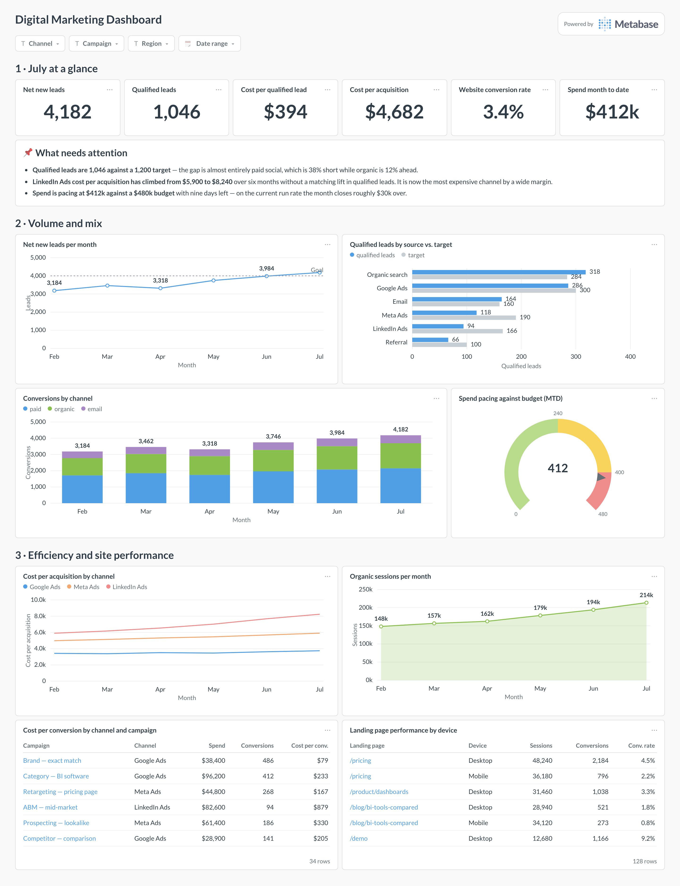
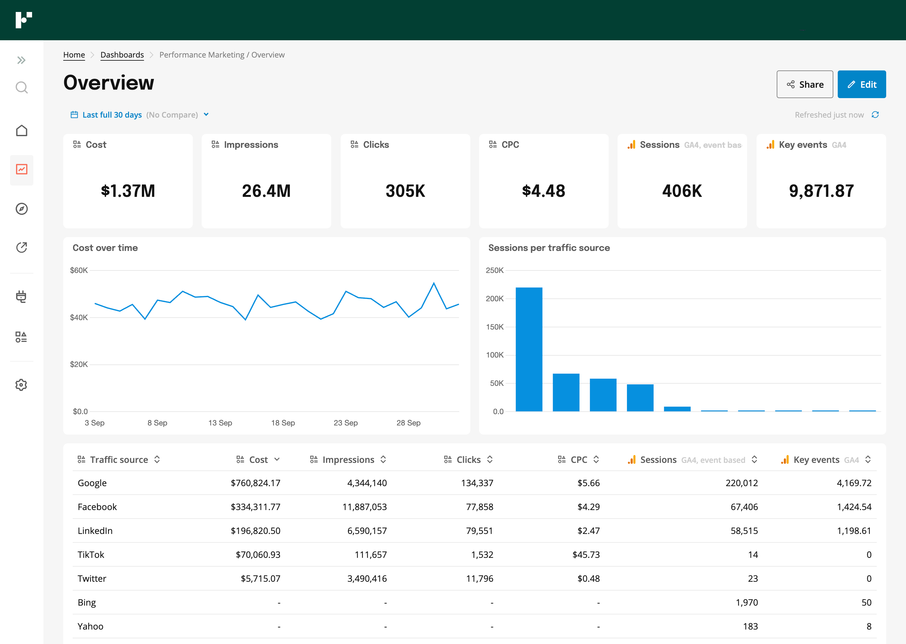

# 마케팅 대시보드 학습 가이드 — 사례·설계·데이터 분석

**현재 프론트에는 ‘요약 → 추세 → 차이의 분해 → 상세 근거’ 흐름을 먼저 적용하는 것을 권한다.** 화면별로 답할 질문을 정하고, 그 질문에 필요한 지표와 비교 기준을 선택한 뒤 차트를 배치한다.

조사일: 2026-10-21. 대상: 마케팅 분석을 공부하면서 현재 워크벤치의 화면 구성을 개선하려는 사람. 공식 제품 예시·공식 문서·원저자 자료를 우선 확인했다. 아래 구성안과 학습 순서는 이번 조사의 **적용 제안**이며, 확정 설계나 구현 완료 기록이 아니다.

## 1. 어디부터 공부할까

| 순서 | 볼 내용 | 공부한 뒤 직접 해 볼 일 |
| --- | --- | --- |
| 1 | 2절의 Metabase·Funnel 예시 | 각 영역이 답하는 질문을 한 문장씩 적는다 |
| 2 | 3절의 설계 절차 | 현재 화면 하나의 사용자·질문·판단·필요 지표를 정한다 |
| 3 | 4절의 기간 비교·세그먼트·지표 분해 | 합계와 비율을 구분하고 비교 조건을 설명한다 |
| 4 | 5절의 지표 정의 | 화면 숫자의 분자·분모·단위·기간을 확인한다 |
| 5 | 6절의 화면 구성안 | 기존 화면에 필요한 요소와 덜어낼 요소를 표시한다 |
| 6 | 퍼널·코호트·실험·기여도 | 현재 자료로 가능한 분석과 추가 조건을 구분한다 |

처음에는 **광고 성과 화면 하나**로 연습하는 편이 좋다. 광고비·클릭·매체 보고 전환·귀속 가치가 있어 규모와 효율의 차이를 공부하기 쉽다. 현재 자료가 가상 표본이라는 점은 계속 표시한다.

이미지를 더 비교하고 싶다면 기존 [시각 비교 보드](index.html)와 [40개 상세 목록](catalog.md)을 함께 본다. 기존 보드의 R번호는 참고 자료 식별자다. 아래 추가 자료 2개는 이 학습 문서에 직접 연결했으며 기존 보드 목록을 바꾸지는 않았다.

## 2. 먼저 볼 대시보드 사례 8개

### 2.1 전체 구성: Metabase Digital Marketing

[공식 설명·예시](https://www.metabase.com/dashboards/digital-marketing)



- **볼 부분:** 공통 필터, 핵심 숫자, 주의할 항목, 규모·채널 구성, 효율, 상세 표의 순서다. 원문은 이 배치를 주간 검토 흐름으로 설명한다.
- **우리 적용:** 상단에는 현재 상태, 중앙에는 변화와 비교, 하단에는 검토할 캠페인·제품을 둔다. 주의 항목에는 해당 수치·기간·근거를 연결한다.
- **주의:** B2B 리드 획득 사례다. 리드·적격 리드·CAC를 우리 제품 판매 지표로 그대로 바꾸면 정의가 달라진다. 이미지의 게이지도 필수 요소가 아니다. 목표 대비 값은 막대와 기준선으로 표현하는 방안을 함께 비교한다.

질문을 붙여 읽으면 구조가 보인다. ‘현재 상태는?’ → ‘무엇을 확인해야 하나?’ → ‘어느 채널에서 차이가 났나?’ → ‘어느 캠페인을 자세히 볼까?’

### 2.2 광고 실무형: Funnel Performance Marketing

[공식 템플릿](https://funnel.io/templates/performance-marketing) · [광고 전용 예시](https://funnel.io/templates/paid-ads-overview)



- **볼 부분:** 기간·비교 설정 아래에 KPI를 두고, 비용 추이와 유입 경로 비교를 거쳐 매체별 상세 표로 내려간다. 광고 데이터와 GA 지표는 출처를 구별한다.
- **우리 적용:** T13 광고 성과의 기본 구성 참고. 상단 요약과 하단 표가 같은 선택 조건을 사용하게 하고, ‘매체 보고’와 ‘사이트 관측’을 라벨로 구분한다.
- **주의:** 광고 클릭, GA 세션, GA 핵심 이벤트는 서로 다른 측정값이다. 옆에 배치했다는 이유로 한 사용자 경로처럼 이어 계산하지 않는다. 우리 자료에 없는 세션 연결을 만들어 넣지 않는다.

### 2.3 성과 해석 조건: Northbeam Overview — 기존 R08

[공식 설명](https://www.northbeam.io/features/overview-page) · [기존 보존 이미지](screenshots/R08-northbeam-1.png)

공식 페이지는 귀속 모형·회계 모드·룩백 조건을 공통 필터로 제시한다. 기존 이미지에서도 귀속 모형과 귀속 기간을 지표 위에 배치했다.

**배울 점:** 수치를 보기 전에 그 수치가 어떤 조건에서 계산됐는지 알 수 있어야 한다. 우리 화면에서는 지원하는 귀속 정의를 표시하고, 정의가 다른 매체 수치를 비교할 때 차이를 설명한다. 실제로 계산할 수 없는 모형 전환 버튼을 장식으로 만들지는 않는다.

### 2.4 한국어 이커머스 지표: 데이터라이즈 — 기존 R10

[공식 지표 소개](https://www.datarize.ai/metrics) · [기존 보존 이미지](screenshots/R10-datarize.png)

공식 페이지에서 매출·세션·전환율·객단가와 채널·상품별 분석을 함께 볼 수 있다.

**배울 점:** 한국어 지표명과 금액·비율·변화량을 읽는 방식. 우리 화면에서는 원화뿐 아니라 엔·달러 표시, `%`와 `%p`, 수량과 인원을 구별한다. 소개용 이미지의 그림자·광택·수치 정의를 그대로 복제할 필요는 없다.

### 2.5 질문별 분석 묶음: Mixpanel Marketing KPIs

[공식 템플릿 모음](https://mixpanel.com/template-gallery) · [Marketing KPIs](https://mixpanel.com/template-gallery/marketing-kpis)

갤러리는 마케팅·웹 분석·이커머스·고객 생애주기처럼 질문과 업무별로 템플릿을 나눈다.

**배울 점:** 같은 데이터를 차트 종류별로 나열하기보다 업무 질문별로 묶는 방식. 우리 워크벤치의 도메인 탐색은 유지하면서, 각 페이지 안에 ‘규모’, ‘효율’, ‘검토 대상’처럼 분석 목적이 보이게 한다. 이번에는 공개 소개를 확인했으며 로그인 후 상호작용을 테스트하지 않았다.

### 2.6 고객군 비교: Mixpanel Lifecycle Analysis

[공식 템플릿](https://mixpanel.com/template-gallery/lifecycle-analysis)

신규·유지·복귀·비활성 고객군이라는 분석 구분을 공부할 때 참고한다. **고객을 어떤 조건으로 묶었는지**가 화면 이름보다 먼저다. 이 생애주기 분류와 ‘가입월 × 경과월’ 리텐션 표는 다른 관점이다.

우리 T30은 현재 한 기간의 코호트 요약이다. 고객군별 표본 수·재구매율·순매출 비교부터 공부하고, 이를 여러 달의 리텐션 히트맵으로 확대 해석하지 않는다.

### 2.7 예산 운영: Metabase Ad Spend Pacing

[공식 예시·계산 설명](https://www.metabase.com/dashboards/ad-spend-pacing)

누적 집행액, 예산, 집행 속도, 월말 예상액, 캠페인 표를 연결한다. ‘효율이 좋은가?’와 ‘예산 계획에 맞게 쓰는가?’를 구분해 공부하기 좋다.

우리 적용에는 먼저 예산과 실제 집행액의 기간·캠페인·통화가 맞는지 확인해야 한다. 단순 일평균으로 연장한 월말 금액은 **균등 집행 가정의 추정치**다. 예약 집행·휴일·행사 집중 기간에는 가정이 맞지 않을 수 있다. T39의 가상 예산 모형을 실제 예측 성능의 근거로 삼지 않는다.

### 2.8 표 중심 업무 화면: Tremor Planner — 기존 R12

[템플릿 원문](https://planner.tremor.so/) · [기존 직접 캡처](screenshots/R12-planner.jpg)

마케팅 사례는 아니지만, 요약 지표 뒤에 검색·필터·그룹화된 상세 표가 바로 이어지는 구성을 참고하기 좋다. 매체·제품·재고 비교처럼 개별 행을 읽어야 하는 업무에 어울린다.

2026-10-15 보존 캡처를 다시 확인했다. 이 자료의 용도는 표의 정보 밀도와 시각적 위계 비교이며, 이번 조사에서 라이브 데모 기능을 재검증한 것은 아니다.

### 예시 자료를 사용할 때 구분할 것

새로 저장한 Metabase·Funnel 이미지는 **공식 공개 예시 이미지**이며 실제 고객 계정의 관찰 결과가 아니다. 수치는 학습용 화면의 일부로만 보고 우리 데이터에 옮기지 않는다. 기존 R08·R10은 10월 15일 보존한 제품 소개 이미지다. 공개 이미지의 배치와 기능 설명을 확인한 범위를 넘어 사용성·정확성·예측 성능이 검증됐다고 해석하지 않는다.

## 3. 화면을 구성하는 방법론

### 3.1 사용자 → 질문 → 판단 → 지표 → 화면

먼저 아래 한 줄을 채운다.

> 이 화면은 **누가**, **어떤 주기로**, **무엇을 확인하고**, **어떤 판단을 내리기 위해** 보는가?

| 화면 목적 | 답할 질문 | 필요한 정보 | 연결할 다음 작업 |
| --- | --- | --- | --- |
| 성과 요약 | 목표나 비교 기간보다 좋아졌나? | 핵심 결과·추세·비교 기준 | 차이가 큰 영역 확인 |
| 광고 분석 | 비용과 성과의 차이가 어디에서 생겼나? | 매체·캠페인별 규모와 효율 | 대상 캠페인 상세 검토 |
| 시장·경쟁 | 자사와 시장의 움직임이 다른가? | 시장 판매액·자사 판매액·점유율 | 브랜드·제품별 분해 |
| 고객 분석 | 어떤 고객 경험을 먼저 확인해야 하나? | 리뷰·주제·문의·표본 범위 | 원문 확인·추가 조사 |
| 운영 상태 | 데이터 누락이나 집행 이탈이 있나? | 수집 상태·계획·기준일 | 누락 확인·운영 검토 |

Microsoft는 사용자의 의사결정과 필요한 지표를 먼저 고려하고, 상세 분석은 연결된 보고서로 내려가게 설계하라고 권한다. NN/g는 빠른 운영 판단과 분석용 현황 파악을 구분한다. 위 표는 두 자료를 현재 업무에 맞춰 재구성한 제안이다. [Microsoft 설계 가이드](https://learn.microsoft.com/en-us/power-bi/create-reports/service-dashboards-design-tips), [NN/g 대시보드 설명](https://www.nngroup.com/articles/dashboards-preattentive/)

현재 제품은 여러 업무의 탐색·표·근거를 담는 워크벤치다. 첫 화면의 요약은 빠르게 읽게 하고, 긴 상세 표와 근거는 아래나 패널에서 확인하는 식으로 역할을 나누면 된다. 전체 앱을 한 화면에 압축할 필요는 없다.

### 3.2 결과 지표와 원인 후보를 연결한다: 지표 트리

지표 트리는 결과를 구성 요소로 나누는 설계 도구다. 예를 들어 광고 효율을 볼 때 광고비, 클릭, 전환, 귀속 가치를 함께 확인하도록 구성한다. 정확히 맞아떨어지는 산술 관계와 검증이 필요한 원인 가설은 구분한다.

North Star 프레임워크는 고객이 얻는 가치를 나타내는 중심 지표와 팀이 영향을 줄 수 있는 입력 지표를 연결한다. 이를 참고해 KPI 간 관계를 정리할 수 있다. 다만 **순매출을 상단에 놓았다는 이유만으로 North Star를 정했다고 부르지는 않는다.** 고객 가치·전략에 관한 별도 합의가 필요하다. [Amplitude 원문](https://amplitude.com/books/north-star/about-north-star-framework)

우리 적용 제안은 화면별 핵심 결과 하나와 설명 지표 몇 개를 먼저 정하는 것이다. ‘KPI는 반드시 몇 개’라는 고정 규칙보다 읽는 사람이 실제로 판단할 수 있는지가 기준이다.

### 3.3 목적이 다른 마케팅을 같은 잣대로 평가하지 않는다

See–Think–Do–Care는 고객의 의도에 맞춰 콘텐츠·마케팅·측정을 정렬하는 프레임워크다. 아래 연결은 우리 화면을 위한 해석이며, 같은 사용자가 반드시 순서대로 통과하는 퍼널을 뜻하지 않는다. [Avinash Kaushik 원문](https://www.kaushik.net/avinash/see-think-do-care-win-content-marketing-measurement/)

| 의도 관점 | 확인할 질문 | 우리 자료의 관련 영역 |
| --- | --- | --- |
| See: 관심을 가질 잠재 대상 | 알려지고 있는가? | 검색 관심·공개 콘텐츠·브랜드 인식 |
| Think: 구매 고려 | 관심이 구체화되는가? | 검색 수요·제품 행동·문의 |
| Do: 구매 의도 | 구매로 연결되는가? | 매체 보고 전환·주문·판매 요약 |
| Care: 기존 고객 관계 | 경험과 관계가 유지되는가? | 고객군 요약·CRM·리뷰·CS |

인지 활동까지 당월 ROAS 하나로 평가하거나, 조회수가 많다는 이유만으로 구매 성과가 좋다고 단정하지 않는 데 도움이 된다. 관련 영역을 나열했다고 교차 데이터의 사용자 연결이 성립하는 것은 아니다.

### 3.4 분석 작업 순서: CRISP-DM을 작게 적용한다

CRISP-DM의 단계는 업무 이해 → 데이터 이해 → 데이터 준비 → 모델링 → 평가 → 활용이다. 필요에 따라 앞 단계로 되돌아가는 반복 과정이다. 대시보드 학습에서는 다음처럼 적용할 수 있다. [IBM 개요](https://www.ibm.com/docs/en/spss-modeler/18.6.0?topic=dm-crisp-help-overview)

1. **업무 이해:** ‘광고 성과가 나빠졌다’ 대신 확인할 지표와 판단을 적는다.
2. **데이터 이해:** 한 행의 의미, 기간, 누락, 통화, 전환 정의를 확인한다.
3. **데이터 준비:** 비교 가능한 범위만 고르고 중복·집계 단위를 맞춘다.
4. **분석:** 추이, 세그먼트, 지표 분해부터 시작한다. 예측 모델은 필요할 때 검토한다.
5. **평가:** 수치 검산과 함께 실제 질문에 답할 수 있는지 확인한다.
6. **활용:** 화면·설명·근거를 연결하고, 사용 중 새 질문이 생기면 다시 정의한다.

### 3.5 시각화는 질문에 맞춰 선택한다

| 분석 질문 | 우선 비교할 표현 | 주의할 점 |
| --- | --- | --- |
| 언제 변했나? | 선 차트 | 결측 구간을 0으로 연결하지 않기 |
| 어느 대상이 크거나 작나? | 정렬 가로 막대 | 시간 순서와 순위 정렬 구별 |
| 전체 중 비중이 어떻게 다른가? | 100% 누적 막대 | 전체 규모도 함께 제시 |
| 무엇이 증감에 기여했나? | 증감 막대·워터폴 | 합계로 분해 가능한 지표에 사용 |
| 목표와 얼마나 차이 나나? | 실제 막대 + 목표 기준선 | 목표의 기간·정의 표시 |
| 두 값이 함께 움직이나? | 산점도 | 상관을 인과로 표현하지 않기 |
| 정확한 값을 비교하고 싶다 | 표 + 정렬 | 단위·분모·표본 수 확인 |
| 같은 고객군의 시간이 흐르면? | 코호트 히트맵 | 관찰하지 못한 미래 칸을 0으로 채우지 않기 |

길이와 위치는 수치 비교에 유리하고, 각도·면적에 의존하는 원형 표현은 정밀 비교가 어렵다는 것이 NN/g 설명의 핵심이다. 위 선택표는 이를 적용한 제안이다. 원형 차트를 전면 금지하는 규칙은 아니다. [NN/g 시각 인지 설명](https://www.nngroup.com/articles/dashboards-preattentive/)

색은 브랜드·매체·상태의 의미를 일관되게 유지한다. 증가는 화살표로, 좋고 나쁨은 지표의 목표 방향으로 구분한다. 국가별 작은 차트를 나란히 둘 때도 축·단위·기간이 같은지 확인한다. [Microsoft 일관성 지침](https://learn.microsoft.com/en-us/power-bi/create-reports/service-dashboards-design-tips)

## 4. 공부해서 적용할 데이터 분석 방법

### 4.1 탐색적 분석: 계산 전에 데이터의 모양을 본다

EDA(탐색적 데이터 분석)는 분포·관계·이상값을 살피고 가정을 확인하는 접근이다. 차트를 많이 만드는 것 자체가 목적은 아니다. [NIST 설명](https://www.itl.nist.gov/div898/handbook/eda/section1/eda11.htm)

현재 프로젝트에서 먼저 확인할 것은 한 행의 단위, 일별·월별 중복, 관측 가능한 기간, 결측, 극단값, 동일 대상의 반복 관측이다. 예를 들어 가격·재고 스냅샷을 여러 날짜에 걸쳐 합산하면 ‘기간 총가격’이나 ‘기간 총재고’가 되지 않는다. **스냅샷은 기준일 상태, 거래·집행은 기간 흐름**으로 읽는다.

적용 UI: 차트 제목 아래에 기간·집계 단위를 표시하고, 자료가 없는 기간과 실제 0을 구별한다. 데이터 품질 문제로 생긴 급락인지 먼저 확인한다.

### 4.2 기간 비교: 현재 값에 맥락을 붙인다

- **전월 대비(MoM):** 최근 변화 확인. 월 길이·요일·행사 차이가 섞일 수 있다.
- **전년 동월 대비(YoY):** 계절이 비슷한 시점 비교. 명절 이동·가격·유통 변화까지 통제되는 것은 아니다.
- **목표 대비:** 달성 정도 확인. 유효한 목표 데이터와 동일한 지표 정의가 필요하다.
- **이동평균:** 짧은 변동을 완화해 추세를 본다. 원래 관측값과 구분하고 창 길이를 표시한다.

이 항목들은 일반적인 비교 방식이며, 어느 방식이 적합한지는 업무와 데이터 범위에 따라 판단한다. H01·T03 월별 자료로는 전년 동월과 월별 추세를 공부하고, T13 일별 분석은 상세 자료가 있는 2026년 8월 범위부터 확인한다. 현재 화면의 비교 선택은 T03·H01 중심이므로 다른 유형에도 이미 구현됐다고 가정하지 않는다.

적용 UI: `값 + 단위 + 비교 대상 기간 + 차이`를 함께 표시한다. 비율의 단순 차이는 `%p`, 상대 증감은 `%`다. 기준값이 0이면 상대 증감률을 무한대나 임의 숫자로 표시하지 않는다.

### 4.3 세그먼트 분석: 전체 평균을 나눈다

국가 → 브랜드·제품 → 매체·캠페인 → 기기·소재처럼 업무에 맞는 차원으로 나눠 본다. 전체 값의 변화가 개별 그룹의 성과 변화인지, 그룹 비중의 변화인지 구분한다. 그룹별 추세와 전체 추세가 다를 수도 있다.

진행 순서: 전체 변화를 확인 → 큰 그룹부터 분해 → 그룹별 규모·효율·표본 수 비교 → 원천 확인. 유리한 세그먼트만 골라 결론을 내리지 않고, 분석 도중 찾은 패턴은 후속 검증할 가설로 둔다.

우리 적용: T13 캠페인, T14 광고 세그먼트, T24 제품별 리뷰, T26 문의 주제. T14를 T13에 더하면 같은 성과를 중복 합산할 수 있으므로 분해표인지 별도 관측인지 먼저 확인한다. 서로 다른 국가의 금액은 현지 통화 상태로 합산하지 않는다.

### 4.4 지표 분해: 어디에서 차이가 났는지 설명한다

**가산 지표:** 캠페인별 광고비처럼 서로 겹치지 않는 부분의 합이 전체가 되는 경우, 각 부분의 전기 대비 차이를 계산해 증감 막대로 비교할 수 있다. 전체 증감이 0에 가까우면 ‘전체 증감에 대한 비율’은 불안정하므로 금액 차이를 우선 보여 준다.

**비율 지표:** 평균 ROAS나 평균 CTR의 단순 평균 대신 분자와 분모를 합산해 다시 계산한다. 전체 효율 변화에는 개별 성과와 지출 비중 변화가 함께 반영된다.

같은 범위에서 광고비를 S, 클릭을 C, 매체 귀속 전환을 V, 귀속 가치를 A라고 하면 다음 산술 관계를 공부할 수 있다.

```text
ROAS = A / S
     = (V / C) × (A / V) ÷ (S / C)
     = 클릭 대비 귀속 전환 비율 × 전환당 귀속 가치 ÷ 클릭당 비용
```

모든 분모가 0이 아니고 같은 원천·기간·귀속 조건을 사용해야 한다. 노출 후 전환까지 섞여 있으면 `V/C`를 순수한 클릭 전환율이라고 부를 수 없다. 이 식은 산술 설명이며 인과 효과의 증명은 아니다. 여러 요소가 동시에 바뀐 경우 단순히 하나를 ‘하락 원인’으로 확정하지 않는다.

적용 UI: ROAS 옆에서 광고비·클릭·전환·귀속 가치를 함께 확인하고, 캠페인 표로 내려간다. 실제 계산은 기존 조회·집계 계층의 정의를 사용한다.

### 4.5 퍼널 분석: 같은 대상의 단계 이동을 본다

올바른 사용자 퍼널에는 **같은 사용자 또는 세션을 연결할 기준, 이벤트 순서, 전환 허용 시간, 단계별 중복 제거**가 필요하다. 열린 퍼널은 중간 단계 진입을 허용하고, 닫힌 퍼널은 첫 단계 진입부터 본다. 단계 이동률은 해당 정의에 맞는 대상 집합으로 계산한다. [GA4 공식 퍼널 설명](https://support.google.com/analytics/answer/9327974?hl=en)

**현재 T18은 상품행 이벤트의 수량 합계다.** 현재 코드도 ‘같은 이용자의 연속 경로 또는 퍼널 전환율이 아님’을 명시한다. 조회 수량과 구매 수량을 나눈 값을 사용자 구매 전환율로 표시하지 않는다. T17의 세션 식별자만으로 T18과 주문의 연결이 완성되는 것도 아니다.

지금은 상품 행동별 수량 막대와 제품·날짜별 비교가 적합하다. 사용자 퍼널을 구현하려면 실제 연결 가능한 식별자·순서·시간 창과 현재 원천의 적합성을 별도로 검토해야 한다.

### 4.6 코호트·리텐션·RFM: 누가 남고 다시 구매하는지 본다

코호트는 공통 조건으로 묶은 집단이다. 리텐션 표를 만들 때는 가입·첫 구매 등 진입 조건, 재방문·재구매 등 복귀 조건, 경과 기간, 분모를 고정한다. 아직 충분한 시간이 지나지 않은 셀은 미관측으로 처리한다. [GA4 코호트 설명](https://support.google.com/analytics/answer/9670133?hl=en)

GA4 문서의 코호트는 기기 데이터 기반이며 해당 탐색에서 User-ID를 고려하지 않는다는 제품별 제약도 있다. 이를 자사 고객 ID 기반 재구매 분석과 동일하다고 가정하지 않는다.

**우리 T30:** 한 기간의 고객군별 표본 수·재구매율·순매출을 비교할 수 있다. 여러 가입월과 경과월의 실제 관측 행렬이 확보됐다는 뜻은 아니다. 기존 비율의 분모·집단 중복 여부를 모르면 표본 가중평균도 전체 고유 고객 재구매율로 단정하지 않는다.

RFM은 최근 구매 시점(Recency), 구매 빈도(Frequency), 구매 금액(Monetary)으로 고객을 나누는 접근이다. [Microsoft RFM 설명](https://learn.microsoft.com/en-us/dynamics365/commerce/set-up-rfm-analysis)

현재 한 기간의 T30 요약만으로 고객별 장기 RFM이나 고객 생애가치(LTV)를 재구성할 수 없다. 이는 후속 학습 항목으로 둔다.

### 4.7 리뷰·문의 분석: 숫자와 원문을 같이 읽는다

현재 T24 리뷰, T25 측면·감성 주석, T26 문의를 연결해 공부한다. 제품별로 불만이 많은 주제를 비교하고 원문을 확인하되, **리뷰 수·주석 수·문의 수는 다른 단위**다. 한 리뷰에 여러 측면 주석이 있으면 주석 비중의 합과 리뷰 비중의 합이 달라질 수 있다.

적용 UI: 주제별 막대 → 선택한 주제의 리뷰 목록 → 원문·제품·작성일·분류 근거. 별점을 감성으로 자동 치환하지 않고, 리뷰를 남긴 사람의 반응을 전체 구매자 만족도로 일반화하지 않는다. 사전 분류가 없는 주제를 새로 붙이는 작업은 원천 검토와 별도 작업 범위가 필요하다.

### 4.8 A/B 테스트·증분 효과: 변화가 실제 효과인지 검증한다

실험은 무작위 배정, 대상·기간, 사전 주 지표, 악화되면 안 되는 보조 지표, 표본 수와 최소 탐지 효과, 종료·검정 방식을 먼저 정한다. 표본 배정 비율 이상(SRM) 같은 품질 문제도 확인한다. 관측된 개선 폭과 불확실성을 함께 보고, 단순 전후 비교를 무작위 실험 결과처럼 설명하지 않는다. [Microsoft 실험 신뢰성 설명](https://www.microsoft.com/en-us/research/?p=680556)

우리 T38은 가상 실험 설계·결과 표본이다. 저장된 실험군·대조군 결과를 읽는 연습에는 쓸 수 있지만 실제 무작위 배정의 적정성이나 집행 효과를 입증하지 않는다. 검증된 추정 구간이 없는 상태에서 신뢰구간을 만들어 그리지 않는다.

적용 UI: 실험 조건 → 군별 표본 → 주 지표 차이 → 제공된 불확실성·품질 정보 → 판단. 점 추정치가 높다는 이유만으로 ‘승자’나 ‘예산 확대’를 자동 표시하지 않는다.

### 4.9 귀속 분석과 MMM: 뒤에서 공부할 주제

**귀속(Attribution)**은 전환의 기여를 접점에 배분하는 방식이다. 어떤 모형·기간·이벤트 정의를 썼는지에 따라 읽어야 한다. 여러 매체가 같은 구매에 기여를 주장할 수 있으므로 매체 보고 전환·가치를 합산한 값은 고유 구매·회계 매출과 다를 수 있다. [GA4 귀속 설명](https://support.google.com/analytics/answer/10596866?hl=en)

**MMM(Marketing Mix Modeling)**은 기간·지역별 마케팅 투입과 성과, 통제 변수를 바탕으로 효과를 추정하는 모델링 접근이다. Google Meridian은 지역 모형에 최소 2년의 주별 데이터, 전국 모형에 3년, 월별만 있을 때 최소 3년을 일반적인 권장치로 설명한다. 이는 모든 MMM의 절대 합격 기준은 아니다. [Meridian 데이터 준비](https://developers.google.com/meridian/docs/pre-modeling/collect-data)

우리 자료는 일부 월별 24개 기간과 제한된 상세 표본이다. 이 기간 길이만으로 실무 MMM의 적합성·인과 식별이 확보됐다고 볼 수 없다. T39 모의 반응 곡선은 실제 학습·검증된 예산 최적화 모델과 구분한다. 현재 프론트에서는 **귀속 정의와 분석 한계를 명확히 보여 주는 일**을 먼저 한다.

## 5. 대시보드에 쓰기 전 확인할 지표 정의

아래는 학습용 정의다. 각 원천의 공식 정의와 기존 계약을 우선하고, 정의가 다르면 화면에 다른 이름을 쓴다. 이 표가 현재 데이터 스키마를 바꾸는 명세는 아니다.

| 지표 | 계산·의미 | 자주 생기는 오해 |
| --- | --- | --- |
| CTR: 클릭률 | 클릭수 합 ÷ 노출수 합 × 100 | 행별 CTR의 단순 평균 |
| CPC: 클릭당 비용 | 광고비 합 ÷ 클릭수 합 | 클릭이 없는데 0원으로 표시 |
| CPM: 1천 회 노출당 비용 | 광고비 합 ÷ 노출수 합 × 1,000 | 매체·기간이 다른 값을 섞음 |
| 클릭 대비 전환 비율 | 동일 범위의 클릭 귀속 전환 ÷ 클릭수 | 사이트 세션 전환율과 동일시 |
| ROAS: 광고비 대비 귀속 가치 | 귀속 가치 합 ÷ 광고비 합 | 이익률·증분 효과·실제 회계 매출로 해석 |
| CPA: 전환당 비용 | 광고비 합 ÷ 정의된 전환수 합 | 전환이 항상 신규 고객이라고 가정 |
| CAC: 신규 고객 획득 비용 | 정의된 획득 비용 ÷ 고유 신규 고객 수 | 광고 CPA를 그대로 CAC로 명명 |
| AOV: 주문당 평균 금액 | 같은 범위의 정의된 주문 매출 ÷ 고유 주문 수 | 주문 상품행 수를 주문 수로 사용 |
| 금액 시장점유율 | 자사 시장 판매액 ÷ 동일 범위 시장 총판매액 × 100 | 행마다 반복된 시장 분모를 합산 |
| 재구매율 | 정의된 관찰 기간의 재구매 고객 ÷ 적격 고객 | 집단 정의·관찰 기간을 생략 |

CTR·CPC의 기본 정의는 [Google Ads CTR](https://support.google.com/google-ads/answer/2615875?hl=en), [Google Ads 평균 CPC](https://support.google.com/google-ads/answer/14074?hl=en)를 참고한다. 전환 비율의 분모가 클릭 외 다른 광고 상호작용을 포함할 수 있다는 점은 [전환 추적 설명](https://support.google.com/google-ads/answer/6270625?hl=en)에서 확인할 수 있다. ROAS는 여기서 배수로 썼으며 백분율 표기와 구분한다.

전환과 귀속의 차이는 [GA4 귀속 문서](https://support.google.com/analytics/answer/10596866?hl=en)를, 우리 필드의 실제 해석은 [공통 의미 규약](../../research/marketing-ontology/common-contract/README.md)을 함께 본다. CAC·AOV 같은 지표는 필요한 비용·고객·주문 범위가 확보됐는지 확인한 뒤 사용한다.

지표마다 메모할 항목은 `업무 질문 / 정의 / 분자 / 분모 / 단위·통화 / 집계 단위 / 기간·시간대 / 대상 범위 / 비교 기준 / 결측 처리 / 출처`다. H01 월별 순판매 요약과 T19 주문 표본은 같은 원장의 요약·상세 관계가 아니므로, 두 값을 조합해 객단가 등을 만들지 않는다.

## 6. 현재 프론트에 적용할 구성안 3개

아래는 데이터 숫자를 넣지 않은 배치 제안이다. 공통 필터와 기존 왼쪽 도메인 탐색을 유지하는 조건으로 작성했다.

### A. 광고 성과 — 첫 학습·적용 대상으로 추천

핵심 질문: **얼마를 써서 어떤 성과를 얻었고, 차이가 큰 캠페인은 어디인가?**

```text
공통 조건: 국가 / 기간 / 일·월 집계 / 캠페인 / 귀속 정의
요약: 광고비 | 매체 보고 전환 | 귀속 가치 | ROAS
주 차트: 선택 지표의 추이          보조: 캠페인별 규모·효율 비교
상세 표: 캠페인 / 비용 / 노출 / 클릭 / 전환 / 귀속 가치 / 비율
행 또는 지표 선택 → 정의 / 계산식 / 사용 원천 / 관련 근거 패널
```

T13을 기본으로, 세그먼트 상세는 적합성을 확인해 T14로 연결한다. 광고비와 ROAS를 같은 축에 겹치기보다 지표 전환 또는 정렬된 작은 차트를 우선 비교한다. 일별과 월별 보고를 동시에 합산하지 않는다. 관측되지 않은 날짜를 채워 연속 그래프로 보이지 않게 한다.

**참고 조합:** Funnel의 전체 배치 + Northbeam의 해석 조건 + Planner의 표 밀도. KPI를 더 늘리기보다 상세 표에서 효율 지표를 함께 읽을 수 있게 한다.

### B. 시장·경쟁 — 시장 성장과 자사 성과 구분

핵심 질문: **시장이 변한 것인가, 자사의 상대적 위치가 달라진 것인가?**

```text
조건: 국가 / 기준월 / 전년 동월 / 브랜드·제품
요약: 시장 판매액 | 자사 시장 판매액 | 자사 금액 점유율
주 차트: 시장·자사 추세를 각각 표시   보조: 브랜드별 점유율 막대
상세 표: 브랜드·제품 / 판매액 / 수량 / 점유율 / 비교 가능한 차이
선택 → 시장 분모 / 표본·포함 범위 / 원천 근거
```

T03 시장 측정과 H01 자사 순판매 요약은 각각의 정의로 읽는다. ‘시장 내 자사 판매액’과 ‘자사 순판매액’을 같은 값처럼 대체하지 않는다. T10 공개 경쟁 광고 표본 수로 경쟁사 광고비·매출을 추정하지 않는다. T33 가상 배경 지수는 시장 성장의 원인 설명에 사용하지 않는다.

### C. 고객·브랜드 — 고객군 현황과 경험 근거 연결

핵심 질문: **어떤 고객군·제품·불만 주제를 먼저 검토할까?**

```text
조건: 국가 / 실제 관측 기간 / 브랜드·제품
고객군 보기: 표본 수 / 보고 재구매율 / 순매출 비교
경험 보기: 리뷰 수·별점 분포 / 측면·감성 / 문의 주제·상태
상세: 선택한 제품·주제의 리뷰·문의 원문
선택 → 분류 기준 / 중복·분모 / 관측 범위 / 근거
```

T30 고객군 요약과 T24·T25·T26 경험 자료는 별도 보기로 시작한다. 공통 제품·국가·기간으로 관련 자료를 열 수는 있지만, 같은 고객이 작성했다는 식의 연결이나 재구매 원인으로 해석하지 않는다. 리뷰와 문의의 관측 범위가 다르면 그 차이를 표시한다.

## 7. 기존 코드에서 무엇을 보면 되나

이번 조사는 코드·데이터를 수정하지 않았다. 나중에 적용할 때 변경 위치를 이해하기 위한 안내다.

| 현재 파일 | 확인할 역할 | 적용할 때의 기준 |
| --- | --- | --- |
| [workbench.tsx](../../../frontend/workbench/workbench.tsx) | 도메인·필터·요약·차트·표·패널 배치 | 먼저 한 페이지의 읽는 순서를 정한다 |
| [marketing-summary.ts](../../../frontend/workbench/marketing-summary.ts) | 업무별 요약 지표·차트 구성 | 지표 정의와 근거를 함께 유지한다 |
| [charts.tsx](../../../frontend/workbench/charts.tsx), [marketing-charts.tsx](../../../frontend/workbench/marketing-charts.tsx) | 차트 표현 | 질문에 필요한 차트만 선택한다 |
| [table.tsx](../../../frontend/workbench/table.tsx) | 상세 표 | 숫자 정렬·단위·비교·선택 동작을 확인한다 |
| [panel.tsx](../../../frontend/workbench/panel.tsx) | 선택 항목의 근거 패널 | 원천·정의·계산 조건을 따라갈 수 있게 한다 |
| [contract.ts](../../../frontend/workbench/contract.ts) | 화면용 계약 | 계산 의미를 화면에서 임의로 바꾸지 않는다 |

현재 확인한 구조에는 요약 지표 선택, 상세 표, 근거 패널과 원천 레코드 보기가 이미 있다. 새 분석 라이브러리 도입 전에 이 요소들로 질문이 해결되는지 확인한다. 이는 소스 확인에 따른 판단이며 이번 조사에서 앱을 실행하거나 브라우저 동작 검증을 한 것은 아니다.

## 8. 직접 공부하는 실습 순서

### 실습 1 — 기존 사례를 질문으로 다시 읽기

Metabase 또는 Funnel 이미지를 열고 각 영역 옆에 ‘이것으로 내릴 판단’을 적는다. 판단을 적기 어려운 차트가 있으면 필요한 이유부터 검토한다. 예시의 수치를 복사하지 않는다.

### 실습 2 — 현재 광고 성과 화면 분석

국가와 자료가 있는 기간을 선택하고 다음 질문에 답한다.

1. 광고비가 큰 캠페인과 ROAS가 높은 캠페인은 같은가?
2. ROAS를 높고 낮게 만드는 분자·분모는 무엇인가?
3. 클릭·전환·귀속 가치가 같은 보고 범위인가?
4. 전체 ROAS는 행별 ROAS 평균과 왜 다를 수 있나?
5. 판단을 확인할 원천과 계산 정의를 어디에서 볼 수 있나?

숫자의 답을 미리 만들어 넣지 말고 현재 자료와 근거로 확인한다. 화면에서 비교할 수 없는 항목은 ‘필요한 화면 개선’으로 적는다.

### 실습 3 — 한 페이지 명세 작성

`사용자 / 핵심 질문 / 판단 / 주요 지표 / 비교 기준 / 차트 / 상세 표 / 근거 / 부족한 데이터`를 한 장에 정리한다. 이 문서 6절의 A안을 출발점으로 삼고, 각 구성 요소가 질문에 답하는지 확인한다.

### 실습 4 — 적용 후 확인할 과제

- 현재 기간과 비교 기간을 설명할 수 있는가?
- 가장 차이가 큰 캠페인·제품을 찾고 규모와 효율을 구분할 수 있는가?
- 표본 수·분모·결측·통화 차이로 판단이 달라지는지 확인할 수 있는가?
- 선택한 수치에서 원천과 계산 정의를 찾을 수 있는가?
- 관측 사실, 가능한 설명, 확인에 필요한 추가 자료를 구분해 말할 수 있는가?

과제 성공 여부로 화면을 검토한다. 보기 좋은 정도만으로 판단하지 않는다.

## 9. 현재 자료의 범위와 조사 근거

프로젝트 기준은 [데이터 보유 기간표](../../design/current-data-coverage.md), [문서 안내](../../README.md), 실제 소스다. 기간표의 2026-10-20 기록은 CURRENT 활성 30,327행이며 **전체가 가상 표본**이라고 명시한다. 이번에 원천 전체를 재검산한 수치가 아니라 해당 문서의 기준값이다.

- T03·H01·T13 등 일부 월별 자료: 2024-10~2026-09. 모든 유형에 동일한 시계열이 있는 것은 아니다.
- 주문·리뷰·가격·재고·광고 세그먼트 등 상세 자료: 주로 2026년 8월의 제한된 기간. 세부 유형·국가별 날짜가 다르다.
- T18: 상품행 이벤트 수량. T30: 한 기간의 고객군 요약. T38·T39: 가상 실험·모형 자료.
- 검색 관심지수: 동일 정규화 범위 안에서 해석. 결측은 0과 구별한다.
- 화면에서 자료 조회가 가능하다는 사실은 모든 자연어 질문이나 분석 기법의 실행 성공을 보장하지 않는다.

### 출처 확인 범위

2026-10-21 공식 본문·공개 목록 확인: Metabase Digital Marketing·Ad Spend Pacing, Funnel 템플릿 2종, Northbeam Overview, 데이터라이즈 지표, Mixpanel 템플릿 목록·개별 소개, Microsoft 대시보드 설계·RFM, NN/g, NIST, GA4 퍼널·코호트·귀속, Google Ads 지표 정의, Amplitude North Star, Kaushik 원문, Meridian 데이터 준비, Microsoft 실험 설명.

IBM CRISP-DM 개요는 공식 페이지의 검색 색인 본문을 확인했으며 직접 본문 요청은 403으로 제한됐다. Google 보고서 갤러리는 목록의 틀만 확인되어 개별 시안을 검토한 사례로 사용하지 않았다. 기존 R12는 보존 이미지 확인 범위다. 로그인·유료 기능·제품의 실제 분석 정확성은 검증하지 않았다.

### 추가 저장 이미지의 원문

| 파일 | 원문 이미지 | 확인 |
| --- | --- | --- |
| `study-20261021-metabase-digital-marketing.webp` | [Metabase 공개 이미지](https://cdn.metabase.com/images/dashboards/digital-marketing-dashboard.webp) | 공식 페이지에서 연결된 파일을 저장하고 시각 확인 |
| `study-20261021-funnel-performance.png` | [Funnel 공개 이미지](https://funnel.io/hubfs/SolutionsHub/Templates/performance_marketing_overview_modal_image.png) | 공식 페이지에서 연결된 파일을 저장하고 시각 확인 |

이미지는 편집하지 않았다. 학습 참고용 공개 자료이며, 재배포·제품 내 사용 권한을 별도로 확인한 것은 아니다.
