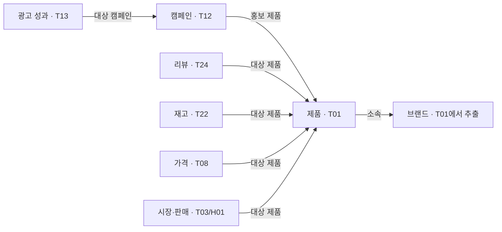

# D003B — 첫 원천 데이터 생성 제안서

2026-10-14. 상태: **사용자 명시 승인 / D003B 원천 1,652건 생성·검증 완료**. 사용자가 첨부한 작업 요청에서 이 제안의 생성 범위와 규칙을 승인하고 생성·검증 완료를 지시했다. [배치 보고서](batches/D003B/report.md), [검증 결과](batches/D003B/validation-results.json)를 참고한다. 이전 D003A의 ‘1,816건 + 공통 기준 정보 최대102개’ 제안은 철회한다. 이번에는 아래 원천 데이터만 만든다. 제품·브랜드·캠페인을 별도 목록으로 다시 복제하지 않는다.

## 무엇을 검증할 것인가

1. **전년 동일 분기 비교:** 2026년3분기와2025년3분기의 선정 제품 판매량·시장 금액 비중·자사 순매출·광고 성과를 계산한다.
2. **상세 상황 조사:** 일본 자사 제품A의 광고 전환 변화와 같은 제품의 재고·경쟁 제품 가격·리뷰·보고 결측을 찾아 원인 후보와 후속 행동을 구분한다.

온톨로지와 실제 그래프 조회가 필요한 이유는 서로 다른 원천의 기록을 제품 ID·캠페인 ID·국가·기간으로 연결하기 위해서다. 원인을 미리 정답으로 넣거나 단순 시간적 일치를 인과 증명으로 평가하지 않는다.

## 제품·국가·기간

| 항목 | 제안 |
| --- | --- |
| 제품 구성 | 자사1·경쟁2브랜드, 각2제품, 총6제품 — 사용자 확정 |
| 카테고리 | 샴푸 — 이번 생성안으로 승인받을 제안 |
| 비교군 | 브랜드마다 A는 일상 세정 사용감형, B는 보습 사용감형. 모두300ml·단일 규격. 같은 비교군끼리 비교 |
| 명칭 | ‘가상 자사 제품A’처럼 역할이 드러나는 한국어 이름. 실제 상표·성분·효능 주장 없음 |
| 국가 | 한국·일본·미국 — 사용자 확정 |
| 텍스트 | 제품명·설명·리뷰·행사 조건·로그 사유 모두 한국어 — 사용자 확정 |
| 통화 | 국가별 KRW·JPY·USD. 환산·국가 간 금액 합산 없음 |
| 시간대 | Asia/Seoul·Asia/Tokyo·미국 모의 계정America/New_York. 미국 전체를 대표하는 시간대라는 의미 없음 |
| 역사 집계 | 2024-10-01부터2026-10-01 미만, 24개월·월별 기록 |
| 상세 구간 | 2026-08-03부터2026-08-31 미만, 28일·완전한 월요일 시작4주 |

국가별 판매처와 자사 재고 위치는 각각1곳이다. 판매처·위치의 코드와 한국어 이름은 해당 가격·재고 기록의 필드에 넣는다. 별도 판매처·창고 목록을 추가 생성하지 않는다.

## 생성할 원천 — 총1,652건

| 유형 | 개수 | 한 행이 의미하는 것 | 핵심 필드 |
| --- | ---: | --- | --- |
| T01 제품 | 6 | 제품 하나 | product_id, product_name, brand_id, brand_name, brand_role, category_name, comparison_group, volume_ml, description_ko, applicable_countries, valid_from |
| T03 시장 성과 | 432 | 6제품×3국가×24개월 | product_id, country_code, period_start, period_end_exclusive, units_sold, sales_value, market_total_value, currency, coverage_text |
| T12 광고 설정 | 6 | 3국가×검색/소셜2캠페인 | campaign_id, campaign_name, platform, channel, country_code, target_product_id, valid_from, valid_to_exclusive, conversion_name, attribution_model, attribution_window_days |
| T13 광고 성과 | 312 | 6캠페인×24개월=144 +6캠페인×28일=168 | campaign_id, country_code, period_start, period_end_exclusive, grain, series_role, impressions, clicks, conversions, spend, attributed_revenue, currency, availability |
| H01 자사 판매 | 144 | 자사2제품×3국가×24개월 | product_id, country_code, period_start, period_end_exclusive, gross_units, returned_units, net_units, gross_sales, returns_value, net_sales, currency |
| T08 가격 | 504 | 6제품×3국가×28일 | product_id, country_code, seller_id, seller_name, observed_at, price, currency, availability, tax_included, shipping_included |
| T22 재고 | 168 | 자사2제품×3국가×28일 | product_id, country_code, location_id, location_name, observed_at, available_quantity, sellable_status |
| T24 리뷰 | 72 | 6제품×3국가×4리뷰 | review_id, product_id, country_code, written_at, language, body_text, rating_value, rating_scale_max, verified_purchase |
| T09 할인 행사 | 1 | 일본 경쟁1제품A의 행사 | promotion_id, product_id, country_code, seller_id, start_at, end_at_exclusive, discount_ratio, conditions_ko |
| T35 자사 변경 로그 | 1 | 일본 자사 제품A의 재고 회복 로그 | change_id, product_id, country_code, location_id, changed_at, changed_field, before_value, after_value, reason_ko |
| T36 수집 로그 | 6 | 상세 광고 보고의 캠페인별 수집 결과 | run_id, campaign_id, country_code, expected_start, expected_end_exclusive, expected_count, received_count, missing_count, missing_dates, status |

공통으로 record_id·is_synthetic=true·source_file·available_at·reporting_timezone를 넣는다. available_at은 해당 기록을 분석에 사용할 수 있게 된 시각이다. 생성 배치 이름·재현 규칙·파일 해시는 파일 관리 기록으로 남기고 ‘추가 마케팅 정보102건’으로 계수하지 않는다.

금액 필드는 소수 문자열과 currency를 함께 사용한다. 개수는 정수, 비율은0–1, 시각은시간대 포함ISO, 기간은시작 포함·종료 제외, 결측은null이다. 필드 의미는 이 제안서와 스키마 문서에 작성하며, 가짜 ‘지표 설명 레코드’를 추가 생성하지 않는다. 의미는 다음과 같이 고정한다.

- 제품A/B의 이름·브랜드·용량은 T01에 있다. 다른 원천은 product_id로 연결한다.
- 캠페인 이름·홍보 제품·구매 전환 정의·귀속 설정은 T12에 있다. T13은 campaign_id로 연결한다.
- T01에는 국가 공통 상품 정보, 관측/성과 기록에는 실제 대상 country_code를 넣는다.
- 판매액은 할인 후·환불 전, 순매출은 판매액에서 환불액을 뺀 값이다. 세금·배송비는 제외한다.
- 시장 분모는 같은 국가·월·모의 유통 범위의 전체 금액이다. 선정6제품 내부 비중과 시장 분모 기준 비중은 별도로 계산한다.
- 광고 전환은 해당 플랫폼이 보고한 구매 전환이며 자사 전체 주문 수와 같지 않다.

기존40유형 필드 사전/JSON Schema는 폭넓은 조사 초안이다. 이번 첫 배치는 위 직접 필드 구조를 사용하며, 기존 scope_id·MetricDefinition·SourceArtifact 등의 참조 레코드를 요구하는 방식은 적용하지 않는다. 위 필드를 기계 검사용 스키마로 옮기는 일은 값 생성 전에 수행한다. 대상·필드·생성 규칙의 범위가 달라지는 변경은 다시 제안한다.

## 수치 생성 규칙

모든 수치 범위는 실제 시장 가격이나 사업 성과를 추정한 것이 아니라 검증용 가정이다. 승인 후 고정 난수 규칙으로 재현 가능하게 생성한다.

| 항목 | 범위·계산 규칙 |
| --- | --- |
| 제품 가격/월 실현 단가 | KRW8,000–25,000 / JPY800–2,500 / USD8–25. 같은 비교군 제품끼리 각 국가 기준 가격대가 겹치도록 선택. 관측 가격과 월 실현 단가는 구별 |
| T03 월 판매량 | 제품·국가별100–5,000개. 판매액=판매량×그 달 실현 단가 |
| T03 시장 분모 | 같은 국가/월의6제품 판매액 합계+기타 제품 금액. 기타 금액은6제품 합계의1–3배. 기타 개별 제품은 만들지 않음 |
| H01 월 판매량 | gross_units는50–800개이며 동일 제품 T03 판매량 이내. 반품 수량0–5%, net_units=gross_units−returned_units |
| H01 금액 | gross_sales=gross_units×자사 월 실현 단가. returns_value=returned_units×같은 단가, net_sales=gross_sales−returns_value |
| T13 월 노출/클릭/전환 | 노출10,000–300,000, 클릭은노출의0.5–3%, 기본 구매 전환은클릭의1–5%. 정수 반올림; 감소 시나리오 구간은 아래 별도 규칙 |
| T13 일 노출/클릭/전환 | 노출500–5,000, 클릭은노출의0.5–3%, 기본 구매 전환은클릭의1–5%. 반올림한 전환0과결측null을구별 |
| T13 지출/귀속 가치 | spend=clicks×모의CPC, attributed_revenue=conversions×제품A모의단가. CPC는KRW200–1,500 / JPY20–150 / USD0.2–1.5 |
| T22 정상 재고 | 자사 제품·국가별150–600개. 상세 입출고 거래는 만들지 않으므로 완전한 재고 수불 대사를 주장하지 않음 |

월별 판매·실현 단가는 제품/국가별 기준 수준에서 각각±15%·±5% 변동을 주되 위 범위와 아래 시나리오 조건을 만족시킨다. 범위·산식·시나리오가 충돌하면 값을 범위 밖으로 만들지 않고 생성 로직을 조정한다. 금액은 해당 통화 최소 단위로 반올림한다.

광고2플랫폼은 각각 모의 검색·모의 소셜로 표시한다. T12의 구매 전환 귀속은 마지막 클릭7일이라는 검증용 설정으로 명시하며 실제 서비스 기본값이라고 주장하지 않는다. 두 플랫폼 귀속 전환·매출을 합쳐 자사 주문/순매출이라고 표시하지 않는다.

## 넣을 상황과 원문

| 상황 | 구체적인 생성 조건 | 확인하려는 판단 |
| --- | --- | --- |
| 일본 자사 제품A 악화 | 2026년7–9월 시장 판매량과자사 순판매량을 각각2025년 같은 달보다10–20% 낮게 구성 | 전년 동일 분기 계산·제품 범위 구분 |
| 일본 경쟁1 제품A 성장 | 같은 비교에서 시장 판매량15–30% 증가. 나머지 제품은−5%~+15% | 자사와 경쟁 제품의 변화 구분 |
| 경쟁 할인 | 일본 경쟁1 제품A, 2026-08-10 09시부터08-24 09시 미만10% 할인·이후원복 | 같은 제품군 가격 관측과행사 연결 |
| 자사 품절 관측 | 일본 자사 제품A, 2026-08-12~08-18의09시 재고0·08-19 09시회복 | 재고/판매처 상태 확인을행동으로 제안 |
| 광고 전환 저하 | 해당 제품을홍보하는 일본2캠페인의품절 관측 날짜에전환율을정상 구간의0–50%로낮춤 | 시간적 일치를찾되원인 확정/기여율 주장 금지 |
| 보고 결측 | 일본 소셜08-26/27의T13 지표는전부null. 수집로그28기대/26수신/2누락·partial, 다른5캠페인은28/28/0·success | 누락을성과0으로해석하지않는지 |
| 한국어 리뷰 | 제품/국가마다4건: 긍정·부정·중립·혼재 각1, 각1–3문장·1–2측면 | 원문 근거 추출·작은 표본의한계 표시 |

리뷰의 측면은 세정감·사용 후 건조감·향·거품·용기 사용성·가격 만족에서 선택한다. 일본 자사 제품A의부정/혼재리뷰는향·건조감위주로 제안한다. 별점은5점척도에서긍정4–5/부정1–2/중립3/혼재2–4이며 감성을별점만으로추정하지 않는다. verified_purchase=null, 작성일은상세구간이다. 실명·실제리뷰·실제상품URL은생성하지 않는다. 리뷰4건으로시장전체 불만률이나전환감소를입증하지 않는다.

재고 회복 로그는T22에기록할회복수량과일치시킨다. 경쟁 가격 변경은T08의관측값과T09를조회해확인하며 경쟁사내부로그를발명하지 않는다. 제품명·리뷰·설명·조건·사유는모두한국어로작성한다. 캠페인/제품식별자·기술필드명·코드는규격대로유지한다.

T25리뷰 주석144건은미리 생성하지 않는다. 분석 단계에서 실제생성된리뷰를읽고근거문장을추출한다. 정답라벨·모의인과설명은원천에넣지 않는다.

## 시간과 데이터 정합성

- 월별 보고는다음달5일현지12시, 일별 광고는다음날12시, 가격/재고는관측5분후, 리뷰는작성다음날12시, 자사변경로그는발생5분후, 수집요약은09-01 12시에확보된것으로설계한다. 제품/캠페인정의는역사시작부터유효하다. 실제서비스의발표일/SLA를재현한것은아니다.
- T13은월별baseline과일별detail을구분한다. 같은기간의두자료를합산하지 않는다. 일별자료로완전한4주를계산하며결측포함주는partial로표시한다.
- 가산가능한08월지표는알려진상세부분합+잔여분으로계산한다. 잔여분은상세범위밖3일과해당캠페인의보고누락2일의일별기본범위에부합하도록제한한다. 추가일별레코드는만들지 않는다. 비율은분자/분모로재계산한다.
- T08의자사판매상태는동일제품·국가T22재고와맞춘다. 경쟁판매상태는unknown, 세금/배송포함은null. 기본관측가격은KRW/JPY10단위·USD0.10단위로선택하여10%할인액을계산한다.
- 동일제품ID·브랜드ID의내용, 캠페인의대상제품, 통화·시각·기간·파일출처를검사한다. null을0으로바꾸지 않는다.
- 월별집계를일별로분해하지않고, 과거개별주문을만들지않는다. 상세구간밖일별분석·일별전년비교는지원하지 않는다.

## 그래프에 저장하는 방식

1. **T01의6제품 행**을 제품 노드로 적재한다. 브랜드 노드를 표현할 때는 T01의 brand_id·brand_name으로 같은 브랜드를 하나로 묶는다. 별도 브랜드 가상 데이터는 생성하지 않는다.
2. **T12의6캠페인 행**을 캠페인 노드로 적재하고 target_product_id로 제품과 연결한다.
3. 가격·재고·리뷰·시장·판매 기록은 product_id로 제품과 연결한다. 광고 성과는 campaign_id로 캠페인과 연결한다. 국가·시간은 원천 필드로 저장하고 조회 조건에 사용한다.
4. 지표 계산식·검증 규칙은 스키마/코드로 정의한다. 이 설명문을 마케팅 원천 레코드로 복제하지 않는다.
5. 적재 후 그래프 노드 수·관계 수는 별도로 측정한다. 원천 파일은 재적재·검증을 위한 원본이고 추가 기준 데이터 한 벌이 아니다.

분석은 이 관계와 시점 조건으로 근거를 조회한 뒤 계산한다. 답변은 숫자 날짜·3줄 요약·비교표·원천 record_id·계산 방식·한계를 포함하고 품절 점검/경쟁 할인 검토/보고 누락 재확보를 근거와 연결한다. 실제 LLM/API/Ads 집행은 이번 생성 승인으로 실행하지 않는다.

## 이전 제안에서 뺀 것

- ‘공통 기준 정보 최대102개’ 전체: 별도 생성 없음.
- T02 모의 외부 상품 매핑18건: 모든 원천이 같은 product_id를 사용하므로 첫 묶음에는 불필요.
- T25 리뷰 측면 주석144건: 원문 분석 결과이므로 생성할 원천에서 제외.
- T35 경쟁 가격 변경2건: 가격 관측과 행사에서 확인할 수 있으므로 별도 원천에서 제외.

따라서 이전 원천1,816건에서18+144+2를 빼 **1,652건**이다. 추가 브랜드·판매처·지표 목록 수를 더하지 않는다. 전체18개 영역의 검토 목록은 유지하되 이번에 모두 생성하지 않는다.

## 근거·승인

자료 형태의 근거는 [소스 목록](data-source-register.md)의M01/M04광고, M27시장, M12자사 판매, M15/M40가격, M13재고, M18제품 리뷰를 참고했다. [시간 계약](temporal-design.md)의 중복 합산/기간 정합성 규칙도 적용한다. 이번 범위·수치·사건·문장은 모두 우리의 검증용 가정이다.

당시 승인 질문은 ‘이 범위와 규칙으로 D003B 원천 데이터1,652건을 만들까요?’였다. 2026-10-14 사용자 첨부 요청으로 이 범위의 명시 승인을 받았고, 별도 [D003B 배치 폴더](batches/D003B/report.md)에 생성·검증했다. 추가 기준 목록·원천 필드·사건을 만들지 않았으며 기존 앱·기존 가상 자료·Git 이력은 변경하지 않았다. DB/LLM/API 연결은 승인 범위 밖이며 미실행이다.
