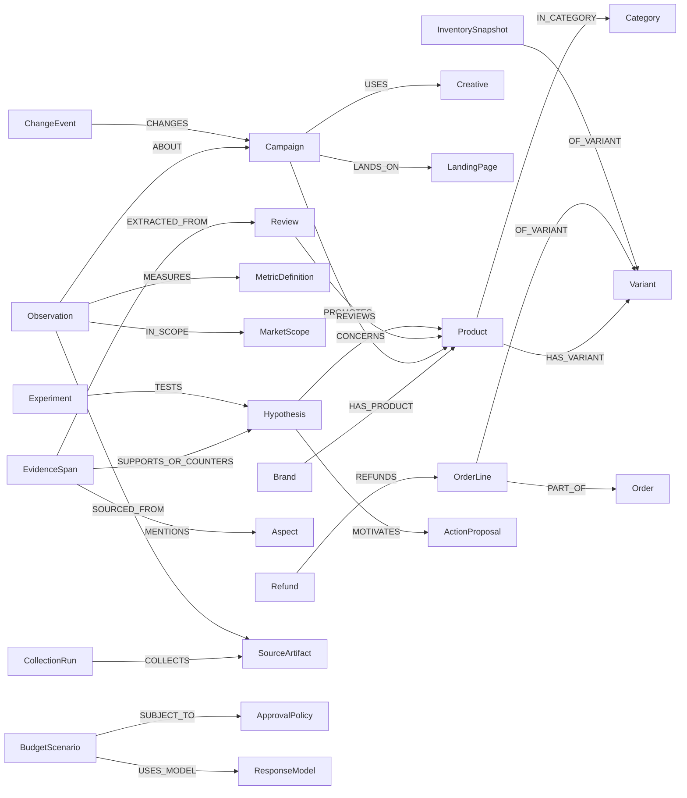

# 실제형 자료를 연결하는 온톨로지·LLM 데이터 설계 제안

시간·집계·그래프의 최신 설정은 [시간 계약](temporal-design.md)과 [40유형 설정표](temporal-catalog.md)를 적용한다. MEASURED_DURING/OBSERVED_AT/VALID_DURING·자료 확보 시각·baseline/detail·H01 역사 보고서를 추가했고, 과거6개월 제안은 대체했다.

2026-10-13. [18분류·40유형](data-landscape.md)과 [44개 소스](data-source-register.md)를 바탕으로 작성했다. 현재 [최소 명세](ontology-spec.md)의 확장 제안이며 승인된 실제 데이터 그래프가 아니다. LLM·Neo4j·API는 아직 연결하지 않았다.

사용자 의도는 기존 CTI 수치를 구조 변환하는 데서 더 나아가, 실제 마케팅 자료와 유사한 원천·문서를 LLM이 관계 조회로 찾아 분석하게 하는 것이다. 기존 D001은 미승인으로 유지하되 이번 자료 선택 후 재검토한다. 새 가상 자료 생성은 이번 요청의 조사 범위에 포함하지 않는다.

## 1. 원천·측정·해석·행동을 연결

| 모듈 | 개체·관계 제안 | 조사 근거 | 필요한 질문 |
| --- | --- | --- | --- |
| 대상·맥락 | Brand–Product–Variant–Category, MarketScope, Seller, 외부 ID Mapping | T01/T02, M11/M15/M18 | 같은 제품인가? 어느 국가·옵션·비교 집합인가? |
| 광고 | Platform–Account–Campaign–AdGroup–Ad–Creative, TargetSetting, LandingPage | T12–T16, M01/M04/M06 | 비용/타깃/소재/믹스가 바뀌었나? |
| 측정 | Observation–MetricDefinition–대상, 기간·세그먼트·귀속·수집 범위 | T05–T07/T13–T15, M07/M09/M10 | 동일 기준의 수치가 변했나? |
| 행동·판매 | WebEvent/Session, Order–OrderLine–Variant, Refund, InventorySnapshot–Location | T17–T23, M08/M12/M13 | 유입·전환·상품 판매·품절 중 어디서 문제가 생겼나? |
| 경험·문서 | Review/SupportTicket/Article–EvidenceSpan–Aspect/Claim, Event | T10/T11/T24–T29, M18/M19/M22/M25/M31 | 어떤 불만·경쟁 활동이 어느 원문에서 확인됐나? |
| 시장·조사 | PanelObservation/SurveyResult/ExternalObservation, 표본·투영·국가·분류 | T03/T04/T32–T34 | 시장·인지·환경 변화와 자사 변화를 구별할 수 있나? |
| 변경·계측 | ChangeEvent/CollectionRun/Incident–영향 대상·기간 | T35–T37, M33/M07/M32 | 실제 변화인가, 계측/수집/사이트 문제인가? |
| 판단·실행 | Hypothesis–SupportingEvidence/CounterEvidence, ActionProposal, Experiment, ResponseModel, BudgetScenario, ApprovalPolicy | T38–T40, M35/M38/M39 | 무엇을 더 확인하고 어떤 제약하에 행동할 것인가? |

이 목록 전부를 생성·구현하지 않는다. 사용자와 대표 시나리오를 정해 필요한 모듈만 첫 배치에 넣는다. Brand/Creative/Aspect 등의 명칭은 현재 외부 기업 모델에서 가져온 것이 아닌 우리 설계안이다.

## 2. 스키마 관계도

이 그림은 개념 유형만 표시한다. 실제 가상 제품·고객·문장·숫자 레코드가 아니다.

## 3. 원천 간 연결 계약

| 연결 | 확보할 키·기준 | 연결 불가일 때 |
| --- | --- | --- |
| 제품↔상품/리뷰/주문 | 국가·판매처·SKU/ASIN/GTIN·변형·근거 있는 ID 매핑 | 제목 유사성만으로 확정하지 않고 후보 매칭으로 저장 |
| 캠페인↔소재/성과 | 플랫폼+계정+리소스 ID+설정 유효기간 | 이름만 같은 다른 계정/버전을 합치지 않음 |
| 캠페인↔사이트 유입 | UTM/click ID·시각·세션·귀속 기준의 실제 가용성 | 일자별 상관 비교만 가능. 고객별 경로를 만들어내지 않음 |
| 사이트 구매↔주문 | 거래 ID·상품·통화·시점·중복 규칙 | 광고 전환/웹 purchase/주문 수치를 별도 보고하고 차이를 설명 |
| 리뷰/문의↔제품 측면 | 실제 제품 키·원문 발췌·언어·추출 버전 | 연결 정확도 미확인으로 표시 |
| 사건↔수치 변화 | 대상·지역·발생 시각·유효기간·근거 | 시간 일치만으로 인과를 확정하지 않음 |
| 재고↔광고 대상 | Variant/제품 매핑·위치·판매지역·관측 기간 | 범위가 다르면 광고 중단/확대 결정은 보류 |
| 조건변수↔시장 | 통계/기상 지역·기간·분류 대응 | 국가 집계로 개별 고객/매출을 설명했다고 하지 않음 |

## 4. 공통 출처·의미 필드

sourceSystem, sourceRecordId, documentRef, fieldPath/evidenceSpan, fetchedAt, eventTime, periodStart/End, timezone, language, scope, unit/currency, granularity, collectionCoverage, metricDefinitionVersion, transformationVersion, availability, valueOrigin을 권장한다. 실제 source의 필드와 통합 시스템이 붙이는 메타데이터는 분리한다.

valueOrigin은 실측/플랫폼 귀속/공급자 추정/파생 계산/LLM 추출/모의 예측 등 의미를 표현한다. synthetic 여부는 이것과 별도다. 가짜 광고 리포트도 '가상 플랫폼 귀속' 성격을 가질 수 있고, 가짜 리뷰에서 추출한 주제는 '가상 원문 기반 LLM 추출'이다.

정의·스키마와 EvidenceSpan은 자료 역할이 다르다. 수집 문서 URL이 있는 것만으로 특정 주장에 근거가 연결된 것은 아니다. 원문에서 어느 문장/표의 어떤 필드를 썼는지 기록한다.

## 5. LLM이 사용할 자료와 도구

LLM에 모든 그래프 레코드를 한꺼번에 주기보다, 질문의 대상·기간을 확인하고 관계 경로와 계산 도구로 필요한 자료를 조회하는 구조를 제안한다.

| 도구 역할 | 입력 | 실제 처리 | 출력 |
| --- | --- | --- | --- |
| 대상 확인 | 국가·카테고리·제품/캠페인 표현 | ID/별칭/비교 범위 검색 | 일치·모호·미확인과 후보 ID |
| 성과 조회 | ID·기간·지표·세그먼트 | 허용된 그래프 질의·집계 | 관측·출처·귀속·결측·범위 |
| 근거 탐색 | 제품/가설·기간·주제 | 연결된 리뷰/문서/사건과 발췌 조회 | 지지·반대 단서·시간·원문 참조 |
| 계산 | 검증된 관측 ID와 산식 | 서버에서 수치 계산·대사 | 계산 결과·입력·식 버전·오류 |
| 후보 비교 | 목표·예산·제약·모형 ID | 승인된 모의 함수/검증 모형 계산 | 현행/후보·가정·범위·위반 |

LLM의 역할은 자료 선택·해석·가설 비교·설명이다. 수치 계산·유효성 검사·권한 확인은 도구로 분리한다. 자유 텍스트를 곧바로 무제한 쓰기 Cypher나 Ads 변경 요청으로 실행하지 않는다. 실제 LLM 연결·호출 비용·모델 선택은 데이터 범위가 정해진 뒤 별도 구현 작업으로 다룬다.

## 6. 어떤 자료가 있어야 가설을 구별하는가

다음은 시나리오 요구안이며, 사건/수치를 실제로 발생한 것처럼 만들지 않았다.

| 설명 후보 | 최소 단서 자료 | 반대·대안 확인 | 가능한 행동 |
| --- | --- | --- | --- |
| 경쟁 심화/매체 비용 변화 | 지출·노출·클릭·경매/설정·경쟁 활동 | 수집/타깃/플랫폼 믹스·시즌·노출 정의 | 운영 확인·제한 실험 |
| 소재/유입 품질 변화 | 소재 버전·광고 반응·유입·퍼널 | 가격·재고·랜딩·동의/계측 변화 | 소재/랜딩 검증 |
| 제품 경험 문제 | 제품별 리뷰 원문/측면·CS·환불 | 표본/플랫폼 변경·배송/사용조건·시점 | CS/제품 조사 |
| 가격/품절/배송 문제 | 가격/행사·재고·주문/배송·퍼널 | 수요·경쟁·계측·채널 차이 | 상품/운영 개선 검토 |
| 경쟁사 성장 | 시장/경쟁 관심·상품/활동·자사 절대값 | 비교 집합·소스 커버리지·경쟁 지표의 추정 여부 | 경쟁 비교 조사 |
| 수집 장애 | CollectionRun·동의·정정·원천 대사 | 실제 계정/주문 자료도 동반 감소하는지 | 판단 보류·계측 복구 |

관계 조회만으로 진짜 인과 추론이 완성되는 것은 아니다(S03). 데이터로 지지되는 설명 후보·반대 근거를 구별하고, 확정할 수 없으면 추가 실험을 제안하는 것이 현재 적절한 평가 목표다.

## 7. 가상 데이터 생성 전 확정할 제안서

새 제안에는 반드시 다음을 채운다.

1. 국가·카테고리·브랜드/SKU·채널·기간·예산 목표와 선택 이유.
2. T01–T40 중 포함할 유형, 각 유형의 grain·개수·필드·허용 연결.
3. 원천의 실제형 형식: 광고 보고서·주문 행·리뷰 본문·문서·계측 로그 중 무엇을 재현하는가.
4. 숫자 범위·분포·생성 규칙과 합계/비율/귀속/환불/재고/시간 정합성.
5. 문장·사건·제품 속성의 생성 범위와 소스 표시. 실제 기관이 발행한 문서처럼 꾸미지 않음.
6. 관측 가능한 자료와 분석자가 모르는 정보, 지지/반대/혼재/결측을 어느 범위로 넣는가.
7. 파생 값과 기대 검산값, LLM에게 노출할 근거, 별도 평가용 기준의 역할.
8. 저장할 파일·Neo4j 노드/관계·재생성 범위·검증·승인 조건.

완성된 제안서를 보여주고 '이 범위와 규칙으로 만들까요?'라고 묻는다. 이번 문서의 자료 유형·구조 제안은 데이터 생성 승인으로 대체되지 않는다. 기존 D001·새 조사 요청·응답 없는 질문을 승인으로 간주하지 않는다.

## 다음 작업

사용자가 자료 목록을 보고 초기 분석 과제와 핵심 데이터 묶음을 선택할 수 있도록 공유한다. 이후 선택한 범위의 구체적 생성안을 작성해 승인받는다. 자료·기간·언어·가정이 정해지기 전에 가상 원문·수치·seed·변형 fixture를 생성하지 않는다.
