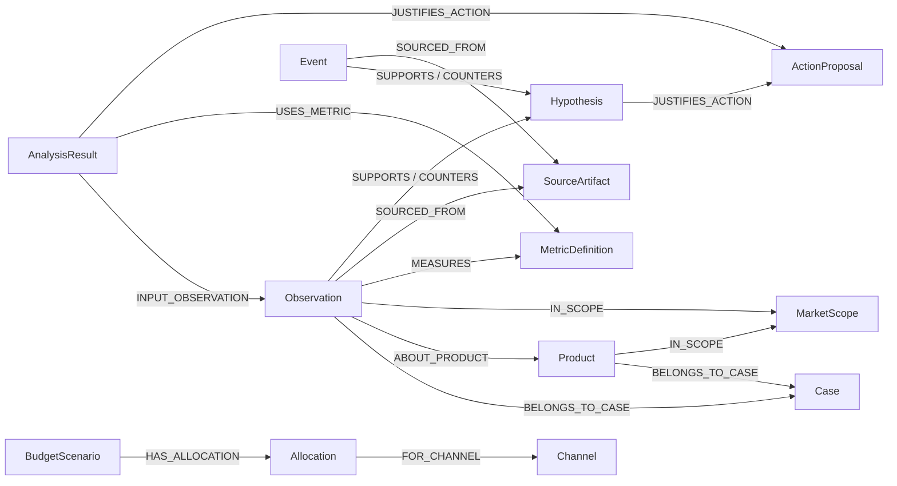

# 최소 온톨로지 명세

2026-10-14: 아래 내용은 CTI/Neo4j 중심의 이전 초안이다. 현재 DB 독립 의미 모델은 [MC-1.0.0](common-contract/semantics.md), 형식 정의는 [ontology.ttl](common-contract/ontology.ttl)·[shapes.ttl](common-contract/shapes.ttl)을 따른다. 기존 가중치·Case·Cypher·D001 조건을 새 공통규약의 보편 규칙으로 적용하지 않는다. [충돌/대응표](common-contract/schema-crosswalk.md)에서 적용 범위를 구분했다.

최신 설정: [시간·집계·온톨로지 계약](temporal-design.md)과 [40유형별 시간 설정](temporal-catalog.md)을 적용한다. 시간 구간/시점·유효 버전·자료 확보 시각·baseline/detail·H01 역사 보고서를 추가했다. 아래 CTI/D001 중심 명세는 이전 최소 모델이며 현재 데이터 생성안이 아니다. 시간 관계는 자동 인과 추론 관계가 아니다.

2026-10-13. 상태: 개념·관계·제약 설계 초안. 데이터 인스턴스·DB·OWL 추론·API 구현은 없음. 독자 설계이며 기업 내부 스키마 재현이 아니다. [Q01–Q06](questions-and-data.md), [자료 S06–S10](research-status.md), [D001](data-proposal.md)을 연결한다.

## 의미 모델과 저장 방식

온톨로지 명세를 Neo4j 속성 그래프로 매핑한다. 이 문서의 클래스·관계·검증 규칙을 실제 적재기·조회·검사에서 적용해야 한다. Neo4j 설치나 그래프 그림만으로 온톨로지 완성을 선언하지 않는다.

W3C의 개념·관측·출처·제약 원칙을 참고한다. RDF Data Cube/PROV-O/SHACL 전체 호환 또는 OWL entailment를 구현한다고 주장하지 않는다. 형식 OWL 호환이 향후 요구되면 매핑·추론 범위를 별도 설계한다.

## 개념과 필수 의미

사례에 종속된 인스턴스는 id, caseId, isSynthetic, source reference를 가진다. 원천 기반 자료와 모형/규칙 기반 결과를 표시로 구별한다. Case는 전역 정의가 아닌 데모 자료의 격리 단위다. 공통 MetricDefinition과 실제 파일 SourceArtifact는 여러 사례가 참조할 수 있고 caseId를 요구하지 않는다. SourceArtifact에는 경로의 실제 존재 여부와 내용의 가상 여부를 별도로 표시한다.

| 개념 | 의미·필수 속성 | 사용하는 질문 | 분류·근거 |
| --- | --- | --- | --- |
| Case | 기존 가상 상황의 격리 단위, 이름·데모 표시 | 전체 | 기존 사례 L01 |
| MarketScope | 국가·카테고리·비교 제품 집합·수집 기준 | Q01/Q02 | 비교 조건, S07/H04 |
| Product | 비교 대상 제품, 표시 이름·사례 | Q01–Q05 | 대상 개체, L03 |
| MetricDefinition | 명칭·정의·단위·집계/산식·버전 | 전체 | 정의, S06/L03 |
| Observation | periodStart/End(ISO 날짜), 수치 또는 결측 상태, 단위·대상·출처 | Q01–Q05 | 관측, S07 |
| SourceArtifact | 실제 원천 파일 경로·SHA256·JSON 위치 또는 필드 경로·synthetic 유형 | 전체 | 출처, S08 |
| AnalysisResult | 질문·조건·계산식 버전·산출값/보류·입력 ID | Q01–Q05 | 계산/규칙 파생, S08 |
| Event | 시작/종료·대상·문장·출처·시간 정확도 | Q04 | 사건 주장, S03 |
| Hypothesis | 원인 후보 문장·근거 상태·한계·추가 검증 | Q04/Q05 | 가설, S03 |
| ActionProposal | 목적·담당 역할·확인 자료·완료·중단 조건 | Q05 | 제안, U01/L01 |
| Channel/Campaign | 매체/캠페인 범위·기간·대상 | Q05/Q06 | 집행 맥락, U01 |
| BudgetScenario/Allocation | 목표·기간·통화·총액/상하한·채널 배분·반응 모형 버전·가정 | Q06 | 모의 제안, S05 |

Event·Hypothesis·ActionProposal·Channel/Campaign·BudgetScenario/Allocation은 후속 데이터 승인 범위다. D001에는 인스턴스를 넣지 않는다.

## 관계 사전

| 관계 | 출발 → 도착 | 의미·개수 | 질문·검사 |
| --- | --- | --- | --- |
| BELONGS_TO_CASE | 사례 종속 자료 개체 → Case | 정확히 1, 서로 다른 사례 격리. 공통 정의·파일 제외 | 전체: case 일치 |
| IN_SCOPE | Product/Observation → MarketScope | Observation은 1, Product는 해당 사례 내 1개 이상 가능 | Q01/Q02: 비교 집합 검증 |
| ABOUT_PRODUCT | Observation → Product | 관측 제품 1 | Q01–Q03: 제품별 계산 |
| MEASURES | Observation → MetricDefinition | 정의 1 | Q01/Q03: 단위·버전 일치 |
| SOURCED_FROM | 원천 자료 개체 → SourceArtifact | 1개 이상, 위치 지정 | 전체: 근거 탐색 |
| INPUT_OBSERVATION | AnalysisResult → Observation | 계산에 쓴 입력 1개 이상 | Q01–Q03: 계산 추적 |
| USES_METRIC | AnalysisResult → MetricDefinition | 출력 정의 1개 이상 | Q03: 산식 버전 |
| SUPPORTS/COUNTERS | Observation/Event → Hypothesis | 가설에 대한 지지·반대 단서 | Q04: 사실 인과 관계와 구별 |
| ALTERNATIVE_TO | Hypothesis → Hypothesis | 대안 설명. 연결만으로 확률·배타성 주장 없음 | Q04: 대안 경로 |
| JUSTIFIES_ACTION | AnalysisResult/Hypothesis → ActionProposal | 검토 이유. 실행·효과를 입증하지 않음 | Q05 |
| PROMOTES/USES_CHANNEL | Campaign → Product/Channel | 홍보 대상·집행 매체 | Q05/Q06 |
| HAS_ALLOCATION/FOR_CHANNEL | BudgetScenario → Allocation → Channel | 채널별 배분과 제약 | Q06: 합계·범위 |

Observation의 identity는 case·시장·제품·기간·지표·출처·수집 기준으로 구성한다. 제품 A와 B의 경쟁 관계는 전역 edge 대신 MarketScope의 비교 집합으로 표현한다. 다른 국가·기간에서 같은 경쟁 집합이라는 주장을 피한다.

## 스키마 관계도 — 가상 레코드가 아님

선은 개념 유형 사이에 허용되는 관계를 표시한다. 실제 제품·수치·사건을 생성한 데이터 그래프가 아니다. BELONGS_TO_CASE는 자료 개체에서 Case로 향하는 단방향 관계다.

## 필수 검증

1. id 중복, 허용되지 않는 유형 간 관계, 사례 간 혼입을 거부한다.
2. Observation의 대상·시장·기간·지표·출처가 모두 존재해야 한다.
3. periodStart < periodEnd. 월별 원천을 일별 관측으로 만들어내지 않는다. 월 종료 경계는 다음 달 첫날을 제외하는 방식이다.
4. value와 availability를 일치시킨다. 결측을 0으로 대체하지 않는다. 결측 이유가 알려져 있지 않으면 미확인으로 표시한다.
5. 같은 정의·단위·비교 대상·수집 기준으로 비교한다. 기준이 다른 관측은 합쳐서 계산하지 않는다.
6. 계산 입력 ID와 산식 버전을 기록한다. CTI 기여 합계, 분모 0, 필수 결측을 검사한다.
7. 원인 후보는 Hypothesis로 유지한다. SUPPORTS 관계를 원인 확정이나 효과 확률로 바꾸지 않는다.
8. 승인된 동일 묶음을 재적재해도 중복을 만들지 않는다. 새 가상 자료는 승인 기록이 있을 때만 적재한다.

## 질문에서 구현으로 연결

Q01–Q03은 허용된 정형 Cypher로 관측을 조회하고 서버에서 비율·변화·기여를 계산한다. Q04는 지지/반대 근거의 부분 그래프와 시간 관계를 반환한다. Q05는 명시한 규칙으로 행동 후보를 구성한다. Q06은 목표·가정을 입력받아 실제 계산한다. 자유 문장에서 임의 Cypher를 만드는 기능은 이번 범위 밖이다.

Node API의 최소 계약은 analysis(context, questionId), graph(context, focusId), simulate(context, objective, allocations, assumptions)이다. 응답에 evidenceIds, 원천 참조, 산식 버전, warnings, 가상 자료 표시를 포함한다. 실제 공개 API는 아직 추가하지 않았다.

화면의 수치·그래프·설명은 동일한 조회 결과를 사용한다. 관측 노드를 선택하면 기간·단위·출처 필드를 확인할 수 있다. DB 실패 시 기존 고정 응답을 실제 계산인 것처럼 대체하지 않는다. 서버 측 연결과 파라미터화한 조회를 사용한다.

## 수용 검사

- D001 승인 후: 192개 관측 후보와 출처 경로가 일치하고, E의 null을 보존하며, Q01–Q03이 기존 검산 결과와 일치하고 사례 혼입·중복이 없어야 한다.
- 데이터 변경 시 결과가 따라 바뀌는 검사는 후속 D002로 변형 규칙을 제안하고 승인받은 뒤 수행한다.
- Q04 이후는 필요한 레코드 승인 후 확인한다. 현재는 관계 경로 명세이며, 실제 인과 효과나 에이전트 추론을 구현하지 않았다.
