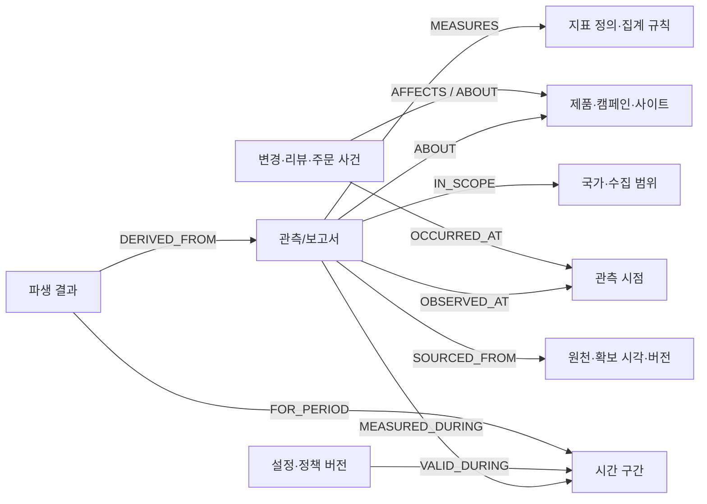

# 시간 간격·집계·온톨로지 연결 계약

2026-10-14 첫 배치 개정: [D003B](first-batch-proposal.md)의 원천1,652건·직접 제품/캠페인 필드가 현재 기준이다. 별도 기준정보102개/300개를 만드는 제안은 철회했다. 아래MetricDefinition·Scope·SourceArtifact 표기는 초기 개념 모델이며 가상 목록을 추가 생성하라는 뜻이 아니다. 지표 의미/집계는 스키마·코드, 국가/출처는 원천 필드에서 읽는다. 시간 의미·중복 합산 금지·기준일 조건은 유지한다.

2026-10-13. 상태: 전면 재설계 초안. 사용자는 서로 다른 시간 간격과 그래프 연결을 고려한 재설정을 요청했다. 이 요청은 가상 데이터 생성 승인이 아니다. [40유형 설정표](temporal-catalog.md)가 최신 수량·기간 기준이며, 기존6개월·23,253건·D002A는 대체되었다.

## 범위와 서로 다른 세 가지 시간

역사 분석 범위는 **[2024-10-01, 2026-10-01)**, 24개월·8완전한 달력 분기다. 2025년과2026년1–3분기의 전년 동일 분기 비교가 가능하고, 2024년/2025년4분기도 비교할 수 있다. 2026년4분기는 범위 밖이다. 제품·브랜드별 관측이 없거나 비교 정의가 바뀐 경우는 비교 불가로 반환한다.

상세 분석 구간은 **[2026-08-03, 2026-08-31)**, 28일·월요일 시작4주로 제안한다. 이 구간에서만 일별 광고/검색/가격/재고와 상세 웹·주문 사건을 만든다는 범위 제안이다. 8월1–2일·31일은 상세 자료가 없으므로 상세 자료 합계를8월 전체 값과 같다고 강제하지 않는다.

| 시간 | 의미 | 사용하는 위치 |
| --- | --- | --- |
| 측정/발생 시간 | 광고 보고 기간, 가격 관측 시각, 주문 발생 시각 | 현상·전후 관계·동일 기간 비교 |
| 유효 시간 | 제품 속성·광고 설정·원가·정책이 적용된 기간 | 사건 당시 유효 버전 조회 |
| 자료 확보 시간 | 발표·수집 후 시스템에서 사용할 수 있게 된 시각 | 기준일 이후 정보 유입 방지 |

발생·게시·수집·확보는 같다고 가정하지 않는다. 통계의 측정 기간은 과거여도 발표 전에는 사용할 수 없다. 정정은 revision과 supersedes_record_id로 기록하고 기준일 이하에서 사용 가능했던 버전을 고른다. 정정 전후를 합산하지 않는다.

## 각 자료의 의미

| 종류 | 해당 유형 | 허용하는 처리 |
| --- | --- | --- |
| 기간 집계 | 시장·광고·유입·코호트·통계 | 단위·분모·범위가 맞는 기간 재집계 |
| 시점 관측 | 가격·재고·공개 콘텐츠 누적 통계 | 해당 시점 값, 승인된 규칙의 직전값 조회 |
| 개별 사건 | 리뷰·댓글·주문·환불·변경·장애 | 실제 발생 시각 기준 건수·전후 탐색 |
| 유효 상태 | 제품·소재·설정·정책·원가 | [valid_from, valid_to) 안에서 적용 |
| rolling 관측 | 성능28일 창 | 창 그대로 비교; 중첩 창 합산 금지 |
| 조사·실험·모형 | 설문·패널·실험·예측 | 조사/학습/예측 기간·표본·불확실성 각각 보존 |

T23/T25/T34/T37/T39처럼 하위 유형이 다른 자료는 record_kind로 시간 의미를 선택한다. 정책의 mixed는 설계 분기 표시이며 실제 temporal.time_kind에 mixed를 넣지 않는다.

기록 간격과 보관 기간은 다르다. 모든 자료에24개월 분량을 강제하지 않는다. T17–T20 상세 사건은 상세 구간만, 리뷰·뉴스 등은24개월의 제한된 표본, 모형의 예측 기간은 승인할 후보별로 별도다.

## 달력·시간대·부분 기간

- 날짜 범위는 시작 포함·종료 제외. 시간대는 IANA ID와 계정/원천 보고 시간대를 보존한다. 한국/일본은 각각 Asia/Seoul·Asia/Tokyo, 미국 원천의 시간대는 계정/모의 사업 조건으로 확정한다. 미국 전체를 한 시간대로 간주하지 않는다.
- 기본 보고 달력은 Gregorian 월/분기, 주는 월요일 시작 ISO 방식. 공급자 주 경계가 다르면 원천 주를 보존하고 calendar_id를 달리한다. 원천 주 값만으로 다른 주 경계를 정확히 복원하지 않는다.
- 국제 비교는 우선 원천의 현지 달력 월/분기 기준이며 정확히 같은 UTC시간 범위 비교라고 표현하지 않는다. UTC기간 비교에는 상세 타임스탬프가 필요하다.
- 월을 가로지르는 주는 월 하나의 자식이 아니다. CONTAINED_IN은 완전히 포함된 경우만, OVERLAPS는 교차를 표시한다. 겹치는 일수만큼 주 매출을 나누는 방식은 기본 금지다.
- 24개월의 모든 일자 노드를 미리 만들지 않는다. 자료가 참조하는 기간/시점만 적재하고 필요한 달력 경계는 조회 시 계산한다. 그래프 노드·관계 수는 원천 레코드 예산과 별도다.
- 완전 기간·부분 기간·자료 결측을 구분한다. 전년 대비 비교는 같은 달력·완전성·제품/지표 정의·수집범위를 요구한다. 2026년3분기와2025년3분기 비교에 없는9월 상세 일자료를 발명하지 않는다.

## 지표별 집계 규칙

MetricDefinition에 aggregation_kind, numerator_metric_ref, denominator_metric_ref, weight_metric_ref, additive_dimensions, deduplication_key, snapshot_rule, maximum_staleness, normalization_group, rolling_window, definition_version을 조건부로 정의한다. 실제 정의값도 데이터 승인 대상이다.

| 지표 성질 | 허용 | 금지/부족 시 처리 |
| --- | --- | --- |
| 지출·클릭·노출·정의된 판매량 | 겹치지 않는 같은 의미의 구간 합 | 월 합계와 같은 월 일자료를 함께 더하기 금지 |
| CTR/CVR/ROAS/평균 주문금액 | 합한 분자÷합한 분모 | 주별·월별 비율 단순 평균 금지; 분모 없으면 재집계 불가 |
| 평균 가격/평균 평점 | 관측 목적에 맞는 원가중치 또는 원문 | 월초 가격을 월평균으로 표시 금지; 평점 표본 차이 명시 |
| 재고·가격 스냅샷 | 해당 관측·기간 말 직전값과 age 표시 | 기간 합계 금지; 시간 가중 평균은 유효 이력 없으면 불가 |
| 사용자·세션·구매자 수 | 대상 기간에서 원키 중복 제거 또는 원천 보고값 | 월별 unique 수 합계로 분기 unique 계산 금지 |
| 검색 상대지수 | 동일 정규화 요청 범위의 추이 | 별도 요청/국가 지수 합산·분할 금지 |
| 시장점유·경매점유·패널·설문 | 같은 범위의 분모/표본가중치로 계산 | 기간/채널/표본이 다른 비율 합산 금지 |
| 누적 콘텐츠 반응 | 같은 콘텐츠·정의에서 연속 관측 차이 | 누적값 합산 금지; 감소/정정은 별도 설명 |
| 백분위·rolling·모형 출력 | 원래 기간/분포/가정 유지 | 평균의 평균·백분위의 평균·중첩 창 합 금지 |

분기 비교를 위해 모든 유형을 분기별 원천으로 복제하지 않는다. 가산 가능한 월별 자료는 분기로 조회 계산하고, 패널처럼 원천이 분기 단위이면 그대로 사용한다. 월별 집계만으로 일별·주별로 내려가는 처리는 하지 않는다.

## H01 역사 집계와 상세 표본

과거 웹 이벤트·주문을 모두 만들면 데이터가 급증하므로 **역사 보고서216건**을 별도 H01로 정의한다. 웹/퍼널72행, 자사 제품별 판매144행. H01은 관측형 모의 집계 보고서이며 일부 상세 주문에서 실제 계산한 전체 실적으로 위장하지 않는다.

H01→MetricDefinition·Scope·Product/Site·TimeInterval·SourceArtifact를 연결한다. 원천 정의의 funnel event 수·순매출/판매량 등 실제 생성할 measures는 다음 생성안에서 승인받는다. HistoricalReport는 T17 사건/T19 주문 스키마와 별도로 검증한다.

상세 자료가 표본이면 coverage_kind=sample·reconciliation=partial_detail로 둔다. 상세 구간 전수로 제안하는 경우는 해당 구간 내 구매/주문/환불을 대사하지만 월 전체 전수로 확대하지 않는다. 광고 플랫폼 귀속 매출과 자사 주문 매출은 귀속·중복 때문에 무조건 같아야 하는 값이 아니다.

## 온톨로지 관계

TimeInterval은 interval_id·start·end_exclusive·timezone·calendar_id·grain·completeness를 가진다. TimeInstant는 timestamp·timezone을 보존한다. 개체 정의만 작성했으며 실제 날짜 노드를 만들지 않았다.

관계 중 MEASURED_DURING/OBSERVED_AT는 해당 시간 종류에만 만든다. 유효 설정이 성과 구간 중간에 바뀌었다면 성과 전체를 새 설정 하나에 귀속하지 않는다. 상세 자료로 분리할 수 없으면 mixed_configuration 경고를 낸다.

TemporalContext는 원천 스키마의 공통 필수 필드로 추가했다. timestamp_field/period_field는 해당 유형의 실재 필드 경로를 가리킨다. time_kind와 경로·기간의 정합성은 후속 의미 검증기가 검사해야 한다. metadata가 자동으로 그래프 관계를 생성하거나 추론을 완료한 것은 아니다.

EVIDENCE_FOR·COUNTER_EVIDENCE_FOR는 원문·관측을 가설에 연결한다. 시간 선후·같은 시장·겹침은 후보 근거를 찾는 조건이다. OVERLAPS·AFFECTS를 입증된 CAUSES로 자동 변환하지 않는다.

## 조회와 LLM에 넘기는 조건

1. 질문에서 목표 기간·비교 기간·국가·제품·기준일·원하는 간격을 확정한다.
2. 기준일 당시 확보된 같은 정의/범위의 최신 버전을 선택한다.
3. 월/분기는 baseline 자료를 우선 선택한다. baseline+detail을 합산하지 않는다. 일/주는 상세 구간에서만 허용한다.
4. 지표의 집계 규칙으로 계산한다. 같은 정의·기간·시간대·커버리지 조건이 실패하면 비교 불가 또는 제한적 문맥 연결로 반환한다.
5. 가격/재고의 직전 관측은 staleness 정책이 있을 때만 사용한다. 관측 공백을 자동 채우지 않는다.
6. 관련 사건·설정·외부 통계는 범위와 시점에 맞게 조회하고, 조사 기간이 겹친다는 것과 사건 직후 효과를 구별한다.
7. LLM에는 period·source_grain·aggregation_method·coverage·as_of·definition_version·evidence_refs·limitations·comparable 상태를 함께 넘긴다.

Cypher에서 관계만 조회하고 집계가 가능한지 판단하는 서버 로직을 둔다. 조회 대상마다 스캔 범위를 제한하고 파라미터를 사용한다. 실제 API·DB·LLM은 이 문서 작업에서 구현하지 않았다.

## 검증 기준 — 실제 데이터 생성 후 적용

- 모든 시간 필드·참조 경로·시간대·시작<종료·주/월/분기 경계 검증.
- 전년 동일 분기 계산은 분자/분모·같은 국가/정의·완전 기간 확인.
- baseline/detail 중복 제거, 정정 버전 선택, 기준일 이후 발표 배제.
- 주간 자료만으로 월간 정확 합계를 만들 수 없는 구간에서 오류 대신 계산 불가 반환.
- H01 전체 보고서와 상세 표본의 범위 차이 표시; missing을0으로 변경 금지.
- 가격·재고 합산 금지, 비율 재계산, unique 합산 금지, 정규화 요청 혼합 금지.
- 설정이 구간 중간에 바뀐 경우·rolling 중첩·부분 월·늦은 환불 검사.

이 검사들은 정의 단계의 요구사항이다. 승인 전 테스트용 마케팅 값도 생성하지 않는다.

## 근거와 설계 가설

| 자료 | 직접 확인한 내용 | 우리 설계에 반영 | 한계 |
| --- | --- | --- | --- |
| [Google Ads Segmentation](https://developers.google.com/google-ads/api/docs/reporting/segmentation) | 날짜 세그먼트와 지표/차원 호환성·세그먼트 증가 시 행 수 증가 | 차원·기간을 무제한 곱하지 않음 | 모든 매체에 같은 조합 적용 불가 |
| [GA4 Engagement rate](https://support.google.com/analytics/answer/12195621?hl=en) | engagement rate는 engaged sessions/전체 sessions | 비율은 분자/분모로 재계산 | 지표마다 별도의 실제 정의 필요 |
| [Neo4j Temporal values](https://neo4j.com/docs/cypher-manual/current/values-and-types/temporal/) | date/datetime와 시간대 등 시간 자료형 | 시각·기간·시간대 속성 보존 | DB 기능이 시간 의미·인과를 자동 검증하지 않음 |

2026-10-13 공식 본문 확인. 날짜/발행일 미표시는 추정하지 않는다. 24개월·28일 상세 구간·15,419건·월초/월말 관측·그래프 관계 명칭은 우리의 설계 제안이며 공급자 권장 표본 규모가 아니다.
